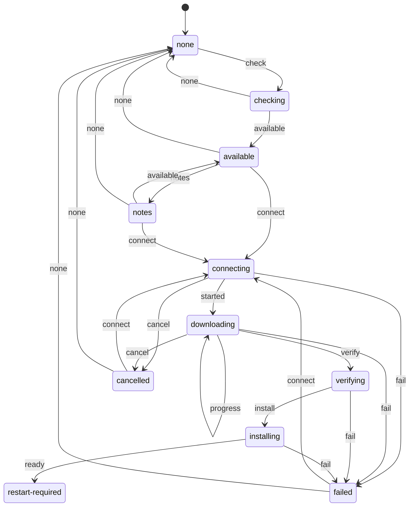
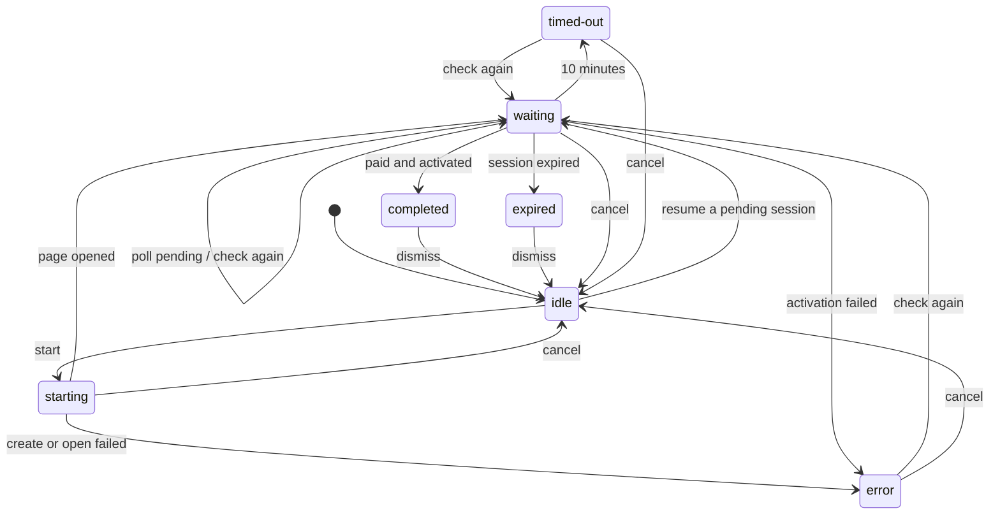
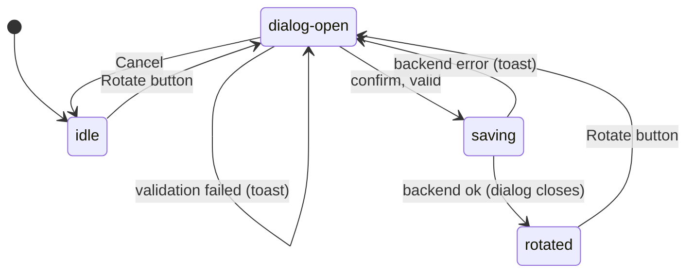
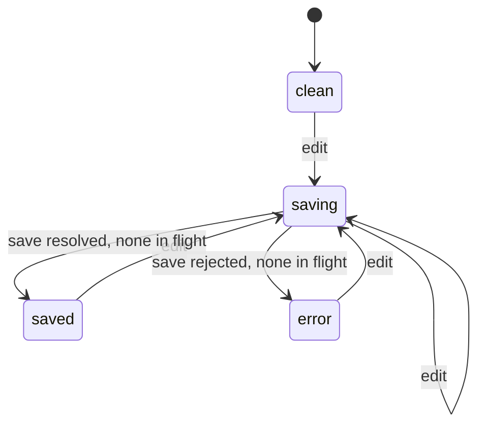
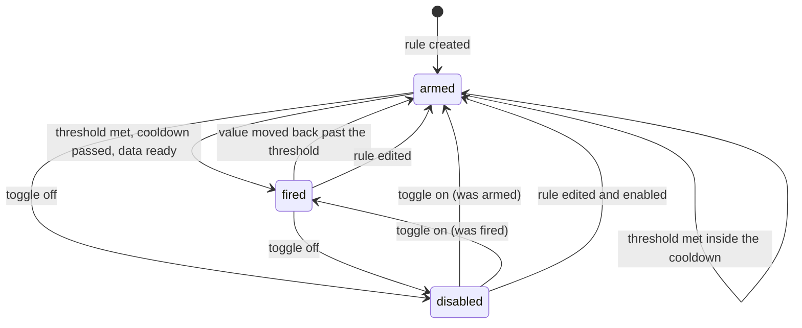
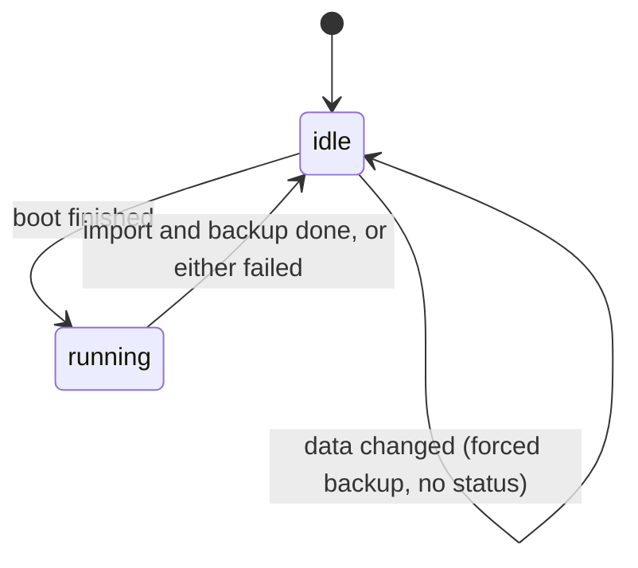

# App domain state machines

Updater, Pro checkout, encryption key rotation dialog, sources auto-save, alert rules and background auto backup. The iOS startup gate is in [startup.md](startup.md). The general conventions are in [README.md](README.md).

## Conventions for UI machines

- **The code is the source of truth.** A table here documents the transitions a component performs. Where the code exports the same table (for example `updateTransitions` in `src/components/auto-updater-state.ts`), a test keeps the two in step.
- **Expose the phase in the DOM.** Put `data-state="<phase>"` on the element that represents the machine. The value is the literal phase from the TypeScript union, never translated copy.
- **Add `data-testid` only when there is no accessible role** to query by, such as a hidden marker element.
- **A hidden marker is allowed** when a machine has no single visible element: ``.
- **A failed step is its own state.** It must be distinguishable from "empty" and from "finished", and the reason shown or logged goes through `redactSecrets`.
- **Tests wait on the marker**, with fake timers or controlled promises. They do not sleep and do not match translated copy to learn the phase.

Each section gives where the state lives, the diagram, the events table, where the state is exposed in the DOM, and the tests that pin it.

## Auto updater

State: `updateReducer` in `src/components/auto-updater-state.ts`, driven by `src/components/auto-updater.tsx`. Timers held by the component: 30 s auto-download after `available`, 20 s first-byte watchdog, 30 s progress watchdog, retry after 2 s, 5 s and 15 s.

| event (action) | from | to |
|---|---|---|
| mount (`check`) | none | checking |
| check found an update (`available`) | checking | available |
| release notes closed (`available`) | notes | available |
| no update, check rejected, Later, close, Escape (`none`) | checking, available, notes, failed, cancelled | none |
| See notes (`notes`) | available | notes |
| 30 s timer, Download, Try again, retry timer, About page event (`connect`) | none, checking, available, notes, failed, cancelled | connecting |
| first byte (`started`) | connecting | downloading |
| chunk received (`progress`) | downloading | downloading |
| download finished (`verify`) | connecting, downloading | verifying |
| download resolved (`install`) | connecting, downloading, verifying | installing |
| install resolved (`ready`) | installing | restart-required |
| watchdog, download or install rejected (`fail`) | connecting, downloading, verifying, installing | failed |
| Cancel (`cancel`) | connecting, downloading | cancelled |
| Hide, Later (`hide`) | connecting, downloading, verifying, installing, restart-required, failed, cancelled | same phase, `visible=false` |
| pill click, About page event (`show`) | connecting, downloading, verifying, installing, restart-required, failed, cancelled | same phase, `visible=true` |

The same table is exported as `updateTransitions`, with `isExpectedTransition(phase, action)`. The reducer still accepts every action. In a dev build it logs a pair outside the table once (`Unexpected updater transition: <action> from <phase>`).

Failure reasons: `network` (retried after 2 s, 5 s, 15 s), `http`, `signature`, `install`, and `other`. `other` is the component's own "Update is no longer available" error, raised when a later check finds no update. It is not retried.

- DOM: `" data-visible="true|false">`, always rendered.
- Tests: `src/components/auto-updater-state.test.ts` (table), `src/components/auto-updater-stall.test.tsx` (marker, retry classes), `src/components/auto-updater.test.tsx`.

## Pro checkout

State: `CheckoutFlow` in `src/middlelayers/checkout.ts`, bound to the page in `src/components/system-info.tsx`. It polls every 3 s, backs off to 30 s while status requests fail, and stops after 10 minutes. The pending session is kept for 24 hours.

| event | from | to |
|---|---|---|
| Subscribe (`start`) | idle, completed, expired, timed-out, error | starting |
| checkout page opened | starting | waiting |
| session could not be created or opened | starting | error |
| poll: pending | waiting | waiting |
| poll: expired | waiting | expired |
| poll: completed, activation ok | waiting | completed |
| poll: completed, activation failed | waiting | error (with the redacted reason) |
| 10 minutes elapsed | waiting | timed-out |
| "I've paid, check again" | waiting, timed-out, error | waiting (or starting when no session is stored) |
| Cancel | starting, waiting, timed-out, error | idle |
| Close (`dismiss`) | completed, expired | idle |
| page mounted with a pending session | idle | waiting |

- DOM: the status card has `data-testid="checkout-status"` and `data-state="<phase>"`. It is rendered for every phase except `idle`, in the narrow layout and above the wide Pro design (1500 px and wider). The wide Subscribe button is disabled in `starting` and `waiting`. The iPhone page (`src/mobile/components/system-info.tsx`) shows the same card without the marker.
- Tests: `src/middlelayers/checkout.test.ts`, `src/components/system-info-subscription.test.tsx` ("checkout state on the wide Pro page"), `tests/e2e/checkout.spec.ts`.

## iOS startup gate

Documented in [startup.md](startup.md#frontend-gate), with the backend states it mirrors. The gate's `data-state` is `checking`, `locked`, `failed-retryable`, `failed-terminal` or `retrying`.

## Encryption key rotation dialog

State: `encKeySaving`, `keyRotated`, `customKey` in `src/components/data-management.tsx`, and the dialog's `rotateOpen` in `src/components/security-design.tsx`. The dialog closes on the result of the operation: `onRotate` returns `Promise<boolean>`. The backend journal and the encrypt write gate are in [key-rotation.md](key-rotation.md).

| event | from | to |
|---|---|---|
| Rotate button | idle, rotated | dialog-open |
| confirm, keys differ, too short, or padded with spaces | dialog-open | dialog-open (toast) |
| confirm, valid | dialog-open | saving |
| backend ok | saving | rotated (dialog closes, inputs cleared, banner shown) |
| backend error | saving | dialog-open (toast with the redacted reason) |
| Cancel | dialog-open | idle, or rotated if a rotation succeeded earlier |

- DOM: the dialog is the `role="alertdialog"` element. Its action button is disabled while saving. There is no `data-state` marker.
- Tests: `src/components/security-design.test.tsx`, `src/components/data-management-blacklist.test.tsx`.

## Sources configuration auto-save

State: `persist` in `src/components/configuration/index.tsx` and `src/mobile/components/configuration/index.tsx`. A counter of saves in flight decides when `saving` ends, so two quick edits stay `saving` until the last one settles. Writes are ordered by the encryption write gate in `src/middlelayers/configuration.ts`.

| event | from | to |
|---|---|---|
| edit (a save starts) | clean, saving, saved, error | saving |
| save resolved, none in flight | saving | saved |
| save rejected, none in flight | saving | error (destructive toast with the redacted reason) |

In `error` the form still shows the values that were not stored. The next edit saves the whole form again.

- DOM: `data-save-state="<state>"` on the page root. On iPhone the Sources root carries it. The iPhone Currency page has no marker.
- Tests: `src/components/configuration/configuration-save-state.test.tsx`, `src/mobile/components/configuration/configuration-save-state.test.tsx`, `src/components/configuration/rename-save.test.tsx`.

## Alert rule lifecycle

State: persisted columns `enabled`, `armed`, `last_triggered_at`, `last_value` and `cooldown_seconds` of `alert_rules`, written in `src/middlelayers/alerts.ts`. This section documents the lifecycle; the code has no marker because the state is data, not UI.

| event | from | to |
|---|---|---|
| evaluation after refresh or at startup: threshold met, cooldown passed, data ready | armed | fired (history row, notification, `armed=0`) |
| value moves back past the threshold by max(0.01, 1 %) | fired | armed |
| threshold met inside the cooldown | armed | armed (no alert) |
| data stale or unavailable | any | unchanged (not evaluated) |
| rule edited and saved | any | armed, cooldown and last value cleared |
| toggle | enabled or disabled | the other one, `armed` kept |

`recordAlerts` re-checks `enabled=1 AND armed=1` and the cooldown in its `UPDATE`, so the startup evaluation and the refresh evaluation cannot fire the same rule twice.

- DOM: none.
- Tests: `src/middlelayers/alerts.test.ts`.

## Background auto import and auto backup

State: `autoBackupStatus` in `src/components/index/index.tsx` and `src/mobile/components/index/index.tsx`, shown by `auto-backup-indicator.tsx`.

| event | from | to |
|---|---|---|
| boot finished (desktop: only when the first load succeeded) | idle | running |
| import and backup done | running | idle |
| import or backup failed | running | idle, with `console.error("auto import failed" or "auto backup failed", <redacted reason>)` |
| data changed (forced backup) | idle | idle; a failure logs `forced auto backup failed` without a reason |

There is no `failed` state yet: a failure is only visible in the log and in the "Last backup" date in Settings.

- DOM: `data-state="running"` on the `role="status"` indicator. Nothing is rendered while idle. On iPhone the same element also appears while an iCloud backup folder is being prepared.
- Tests: `src/components/auto-backup-indicator.test.tsx`, `src/mobile/components/auto-backup-indicator.test.tsx`, "background auto backup observability" in both `index-data-changed.test.tsx` files.
