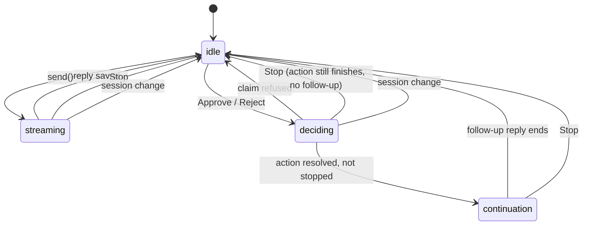
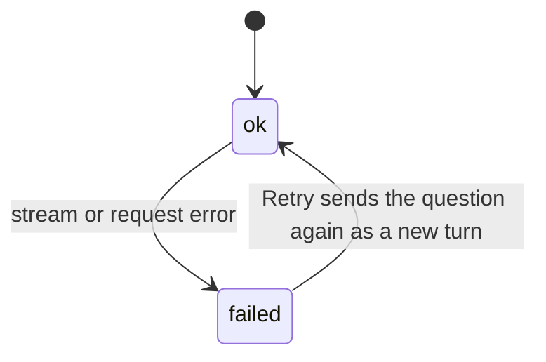
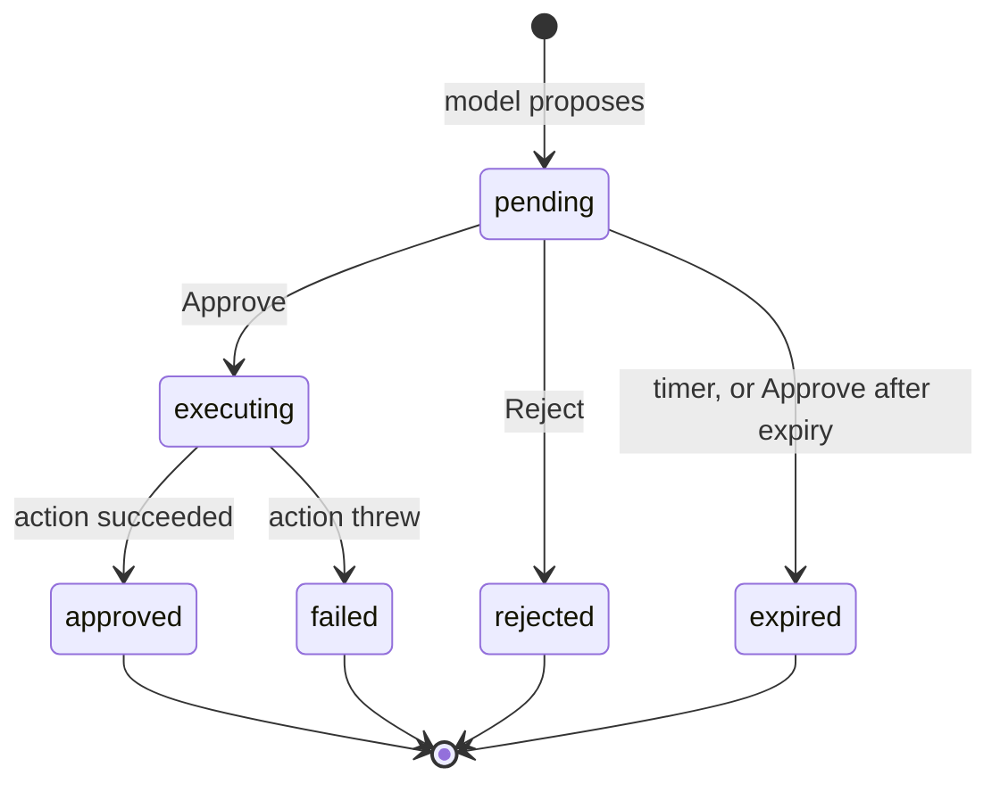
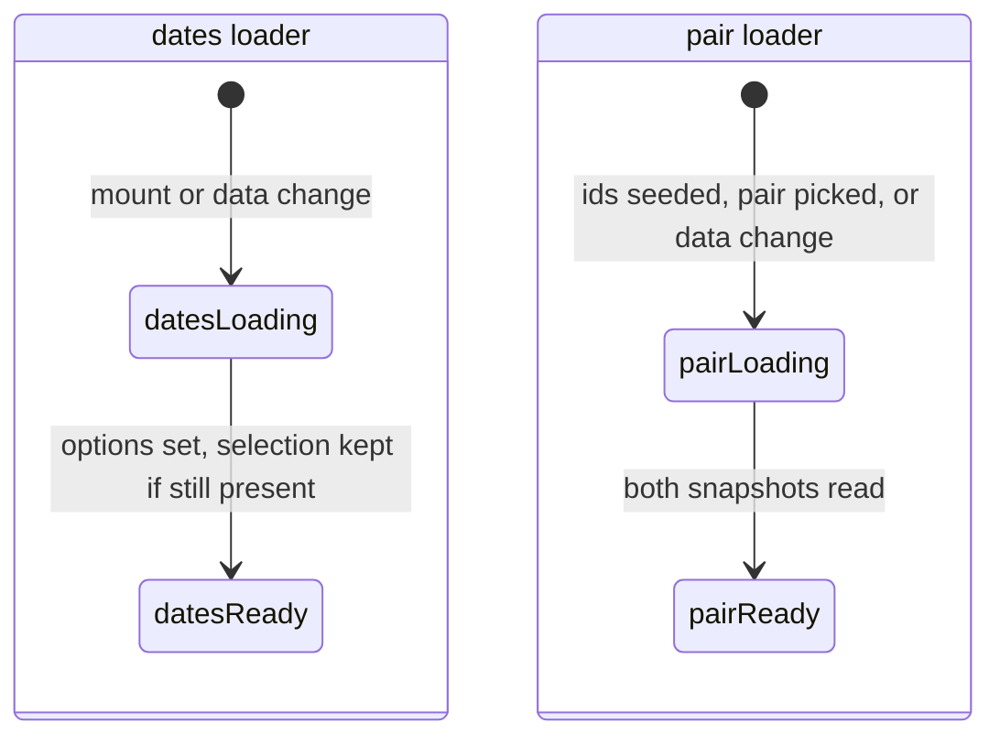
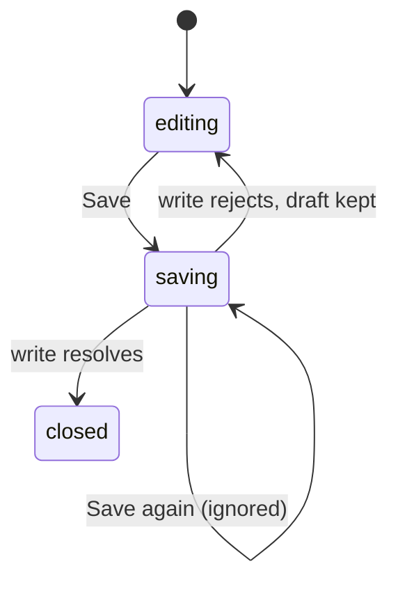
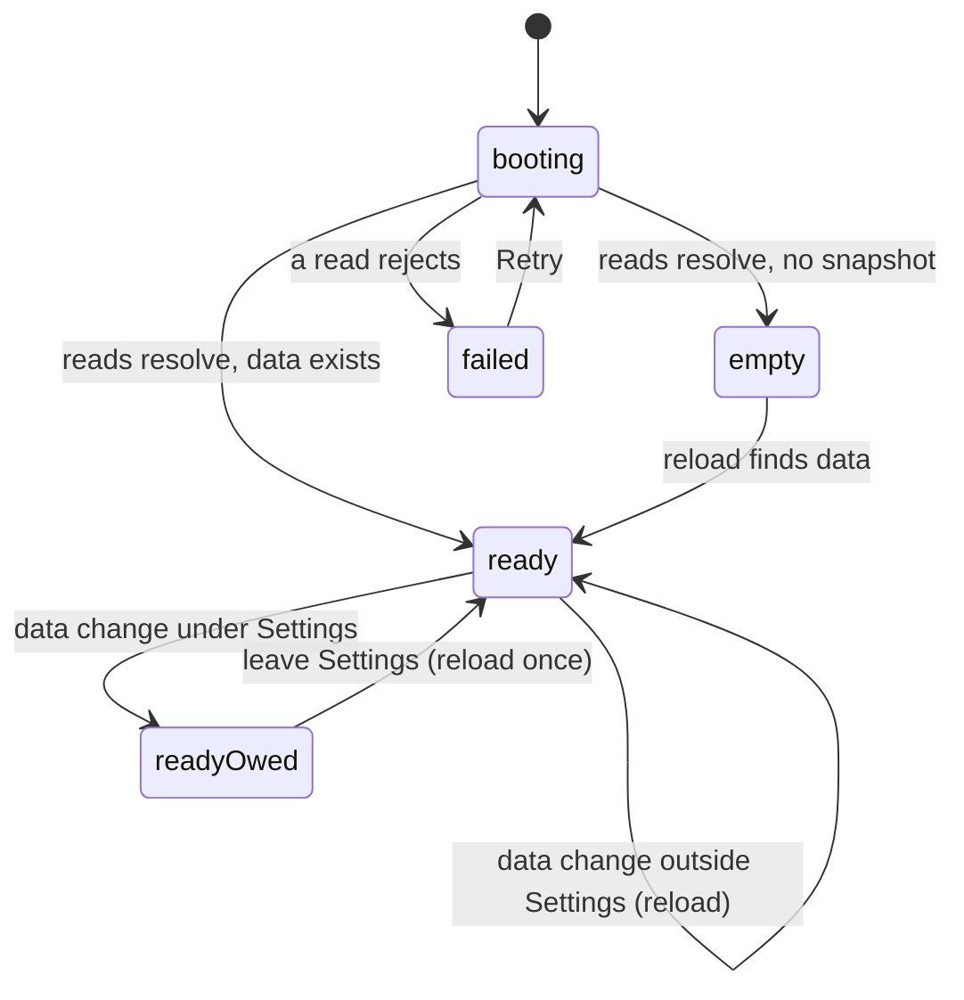

# State machines: assistant, phone shell, comparison, goals

Each section names one machine, where its state lives, the transitions, and the DOM marker a test or an agent can read.
When a machine exists in a desktop and a phone copy, both copies change together.

## 1. Chat turn

Code: `src/components/assistant/use-chat.ts` (`send`, `decideAction`, `stop`). One turn owns `abortRef` at a time; only the owner resets `isStreaming`.

Marker: `[data-testid="chat-card"]` carries `data-state="streaming | idle"` (desktop and phone).



| event | from | to | notes |
|---|---|---|---|
| `send()` | idle | streaming | guarded by `inFlightRef` |
| Approve / Reject | idle | deciding | the approval creates its controller before the first await |
| claim refused | deciding | idle | card unchanged |
| action resolves, not stopped | deciding | continuation | card status updated, follow-up reply requested |
| Stop | deciding or continuation | idle | an executing action cannot be cancelled; it finishes and updates its card, the follow-up is skipped |
| session change | any | idle | a late finish touches nothing |
| a newer turn owns `abortRef` | - | - | the older turn's cleanup leaves the flags alone |

`data-state="streaming"` covers `streaming`, `deciding` and `continuation`.
Timers: provider connect 180 s, stream idle 60 s (`src/middlelayers/ai/provider.ts`); one-shot calls 30 s, summaries 10 s (`orchestrator/llm.ts`).
Agent activity rows pulse only while their reply is streaming.

Tests: `use-chat-actions.test.ts`, `use-chat.test.ts`, both `chat-page.test.tsx`.

## 2. Request error in a reply

Code: `src/components/assistant/request-error.ts` (`splitRequestError`, `isRequestError`), used by both `message-bubble.tsx` files and both `chat-page.tsx` headers.
A failed request is stored in the reply text as `"\n\n[error] <reason>"`. The marker counts at the start of the text or of a line.

Marker: a failed reply's `[data-testid="assistant-bubble"]` carries `data-state="failed"`; the card inside has `role="alert"`.



| block text | state | rendered |
|---|---|---|
| no marker | ok | markdown |
| marker, no 429 | failed | text before the marker, error card with generic copy, Retry |
| marker, `HTTP 429` or `status 429` | failed (rate limited) | text before the marker, error card with rate-limit copy (desktop), Retry |

The chat header says "Request failed" only when the last reply failed.

Tests: `request-error.test.ts`, both `message-bubble.test.tsx`, desktop `chat-page.test.tsx`.

## 3. Pending action card

Code: status union `ActionStatus` in `src/middlelayers/ai/actions/lifecycle.ts`; display in `src/components/assistant/action-card.tsx` (`displayStatus`, `actionHeader`) and `src/mobile/components/assistant/phone-action-card.tsx`.
A proposal expires 5 minutes after it is created.

Marker: the card `<section>` carries `data-state="pending | executing | approved | rejected | expired | failed"`.



| status | header | badge | controls |
|---|---|---|---|
| pending | Approval needed | Waiting | Approve, Reject |
| executing | action name | Executing | none |
| approved | Alert created | Approved | link to Goals |
| rejected | action name | Rejected | none |
| expired, or pending past expiry | action name | Expired | none |
| failed | action name | Failed, with the result | none |

Tests: `action-card.test.tsx`, `phone-action-card.test.tsx`, `lifecycle.test.ts`.

## 4. Assistant page and session

Code: `ReadyChat` in `src/components/assistant/chat-page.tsx` and `src/mobile/components/assistant/chat-page.tsx`.

Markers: `[data-testid="chat-session-layout"]` carries `data-state="blank | loading | ready | load-error"`. The page gate above it has one test id per state: `assistant-loading`, `assistant-not-configured`, `assistant-error`, `assistant-upgrade`, and the layout itself when ready.

```mermaid
stateDiagram-v2
  [*] --> blank: /assistant
  [*] --> loading: /assistant/:id
  blank --> ready: first reply saved, id adopted
  loading --> ready: session read
  loading --> load-error: read failed
  ready --> loading: another chat selected
  load-error --> loading: another chat selected
  ready --> blank: /assistant
```

| event | from | to |
|---|---|---|
| save fails | ready | ready, save error shown |
| next save succeeds, or the session changes | save error | cleared |
| delete fails | any | delete error shown |
| next delete succeeds, or the session changes | delete error | cleared |
| route to `/assistant` | any | blank; messages, summary and timestamps cleared |

Tests: both `chat-page.test.tsx`.

## 5. Comparison loaders

Code: `src/components/comparison.tsx`, `src/mobile/components/comparison.tsx`. Two loaders, each with its own generation ref (`datesGenRef`, `loadGenRef`).

Marker: `aria-busy` on the page root while the pair loads.



| event | dates loader | pair loader |
|---|---|---|
| mount | request D1 | waits for ids |
| D1 resolves | options set, ids seeded | request P1 |
| data change | request D2 | request P2 |
| D2 resolves | options replaced, selection kept | unaffected |
| newer request started | older response ignored | older response ignored |

Tests: both `comparison-page.test.tsx`.

## 6. Goals rule save

Code: `save()` and `toRule()` in `src/components/goals-alerts.tsx` and `src/mobile/components/goals-alerts.tsx`. A `savingRef` holds the write in flight.



| event | from | to |
|---|---|---|
| Save | editing | saving |
| Save again | saving | saving (ignored) |
| write resolves | saving | closed, "Rule saved" |
| write rejects | saving | editing, error shown, draft kept |
| save an edit of a paused rule | paused | paused, re-armed |

Phone threshold sign (`src/mobile/components/goals-fidelity.tsx`): for a move kind the input shows a magnitude and the sign is remembered.

| event | remembered sign |
|---|---|
| editor opened or kind changed, threshold non-empty | sign of the stored threshold |
| editor opened or kind changed, threshold empty | negative when the comparator is "falls" |
| comparator changed on a move kind | initial comparator keeps the initial sign, otherwise negative when "falls" |
| typing on a move kind | `-magnitude` when the remembered sign is negative |

Tests: both `goals-alerts.test.tsx`, `goals-fidelity.test.tsx`.

## 7. Phone shell data load

Code: `App` in `src/mobile/components/index/index.tsx` (`loadAllData`, `onDataChanged`, `onLeaveSettings`, `refreshLocalView`).

Marker: the content area carries `data-boot-state="booting | failed | ready | empty"` next to `aria-busy`.



| event | from | to |
|---|---|---|
| data change outside Settings | ready | reload |
| data change under Settings | ready | ready, reload owed |
| leave Settings with a reload owed | ready, owed | reload, owed cleared |
| pull to refresh, range complete | ready | reload, range kept |
| pull to refresh, range missing | ready, no range | reload, range set to the default |

Tests: `src/mobile/components/index/index-data-changed.test.tsx`.
