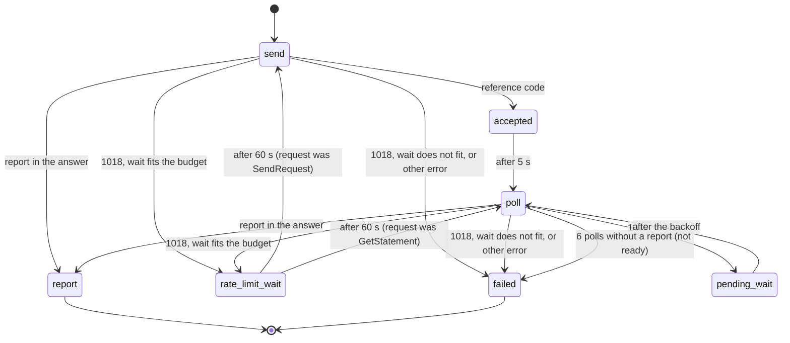

# IBKR Flex

An IBKR broker source reads positions through the Flex Web Service: one request starts a report, then the report is polled until it is ready.

- Code: `IbkrBroker` in `src/middlelayers/datafetch/coins/stock/ibkr.ts` (`fetchFlexXml`, `requestFlex`).
- Budget: a broker source gets 120 s in `fetchPortfolios`. The flow keeps its own budget of 110 s (`flowBudgetMs`) so that it can report its own reason first.

## States

| state | meaning |
|---|---|
| `send` | SendRequest, 20 s timeout |
| `accepted` | a reference code came back; wait 5 s |
| `poll` | GetStatement, 30 s timeout, up to 6 attempts |
| `pending-wait` | the report is not ready (code 1019); wait 1, 2, 4, 8, then 10 s |
| `rate-limit-wait` | code 1018; wait 60 s and send the same request once more |
| `report` | the report arrived |
| `failed` | a typed error: rate limited, not ready, token expired and so on |

## Events

| event | from | to |
|---|---|---|
| answer holds the report | `send`, `poll` | `report` |
| answer holds a reference code | `send` | `accepted`, then `poll` after 5 s |
| 1019 | `poll` | `pending-wait`, then `poll` |
| 6 polls answered 1019 | `poll` | `failed`, "IBKR not ready" |
| 1018 and the 60 s wait fits the budget | `send`, `poll` | `rate-limit-wait`, then the same request once more |
| 1018 and the wait does not fit (elapsed + 60 s + request timeout is over the budget) | `send`, `poll` | `failed`, "IBKR rate limited" |
| 1018 again on the repeated request | `send`, `poll` | `failed`, "IBKR rate limited" |
| any other error code | `send`, `poll` | `failed` with the typed reason |

All requests for one token share a limiter: at most one request per second and ten per minute.

## Where to read it

The flow has no DOM state of its own. Its result becomes the status of the broker source: detail "IBKR rate limited", "IBKR not ready", "IBKR token expired" and so on, shown in the source status dialog. Code 1018 is logged as `IBKR Flex error code 1018`, never with the token.

## Tests

`src/middlelayers/datafetch/coins/stock/ibkr.test.ts`.
