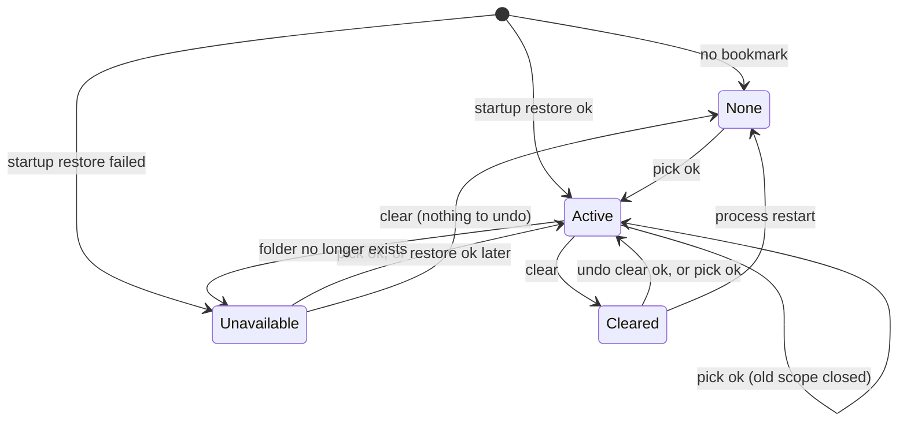
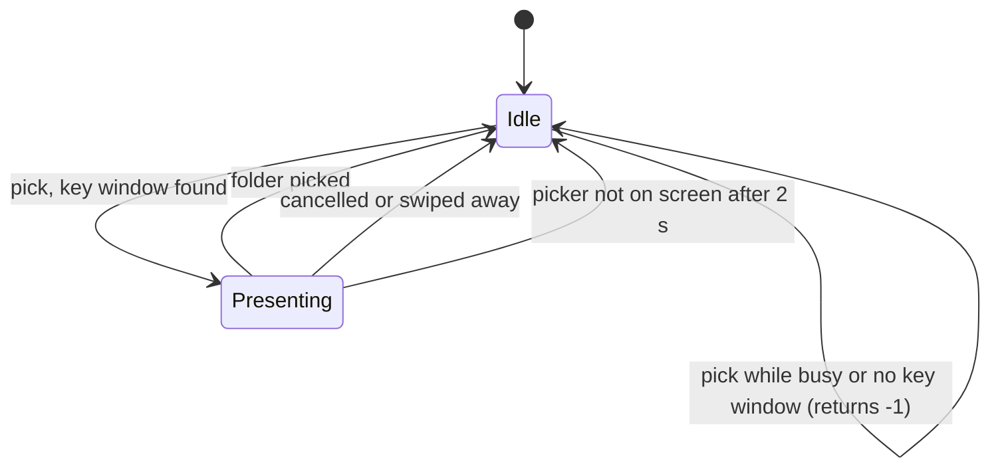

# iOS backup-folder access and folder picker

On iOS a folder outside the app container is reachable only through a security-scoped bookmark. Track3 keeps two folders, selected by `kind`: `0` is the auto-backup folder and `1` is the import folder. The native side is the `Track3BackupFolder` singleton in `src-tauri/gen/apple/Sources/track3/Track3Native.swift`; the Rust commands are in `src-tauri/src/app.rs`; the frontend reader is `src/middlelayers/ios-backup-folder.ts`.

## Folder access (per kind)

State is held in three places that are not updated together: the Swift dictionaries `active` and `cleared` plus the bookmark in `UserDefaults`; the Tauri fs scope, which only ever grows; and one optional failure string in Rust (`IOS_BACKUP_FOLDER_FAILURE`, `app.rs:47`, auto-backup folder only).

| state | bookmark | `active[kind]` | `cleared[kind]` |
|---|---|---|---|
| `None` | no | no | no |
| `Active` | yes | URL, security scope open | no |
| `Unavailable` | yes | the bookmark cannot be opened, or the URL is still held but the folder is gone | no |
| `Cleared` | no | no | URL kept in memory for undo |

| event | from | to |
|---|---|---|
| startup `restore`, bookmark resolves | – | `Active`; fs scope granted |
| startup `restore`, bookmark does not resolve | – | `Unavailable`; failure recorded (kind 0) |
| `pick` returns a folder | any | `Active`; old scope closed, bookmark replaced, fs scope granted, failure cleared (kind 0) |
| `pick` cancelled, busy, or no window | any | unchanged; the command returns `null` |
| `pick` of `track3-backup` or a folder inside it (kind 0) | any | unchanged; error "Choose the parent folder containing track3-backup for auto backup." |
| `restore` (status probe), folder gone | `Active` | `Unavailable`; failure recorded |
| `clear` | `Active` | `Cleared`; bookmark removed, failure cleared (kind 0); the fs scope grant stays |
| `clear` | `Unavailable` (bookmark cannot be opened) | `None`; bookmark removed, failure cleared (kind 0), nothing to undo |
| `undoClear`, folder still reachable | `Cleared` | `Active`; bookmark written again |
| `useImportForAuto` | kind 1 `Active` | kind 0 `Active` on the same folder; failure cleared |
| `prepare` (kind 0) | `Active` | unchanged; failure set to the prepare error, or cleared on success |
| process restart | `Cleared` | `None` |

### Mutation sites

| site | what changes |
|---|---|
| `Track3Native.swift:417-420`, `pick` | `active`, `cleared`, bookmark |
| `Track3Native.swift:443`, `449`, `restore` | refreshed stale bookmark, `active` |
| `Track3Native.swift:458-461`, `clear` | `active`, `cleared`, bookmark removed |
| `Track3Native.swift:472-474`, `undoClear` | `active`, `cleared`, bookmark |
| `Track3Native.swift:492-495`, `useImportForAuto` | kind 0 `active`, `cleared`, bookmark |
| `app.rs:424` `allow_backup_folder` | fs scope grant (never revoked) |
| `app.rs:683`, `690`, setup | failure set from the startup restore or grant |
| `app.rs:475`, `ios_pick_backup_folder` | failure cleared |
| `app.rs:490`, `498`, `ios_backup_folder_status` | failure set from a failed grant or restore |
| `app.rs:536`, `ios_use_import_backup_folder` | failure cleared |
| `app.rs:548`, `ios_clear_backup_folder` | failure cleared |
| `app.rs:586`, `ios_prepare_backup_folder` | failure set or cleared from the prepare result |

## Folder picker bridge

`pick` blocks a Rust worker thread on a semaphore while the system document picker is on screen.

| event | from | to |
|---|---|---|
| `pick`, key window found | `Idle` | `Presenting` (`waiting` and `presentedPicker` set, lines 388-392) |
| `pick` while a pick is running, or no key window | any | unchanged; returns -1, which Rust maps to `Ok(None)` |
| folder picked, cancelled, or sheet dismissed | `Presenting` | `Idle` (`finish`, lines 503-509) |
| one check 2 seconds after presenting finds no picker on screen | `Presenting` | `Idle` (line 403) |

## Tests that pin this

Nothing pins the Swift tables; they can only be exercised on a device or simulator. `backup_folder_path_tests` in `src-tauri/pure-tests/src/lib.rs` covers the pure path rules of `ios_backup_path.rs`, and the e2e bridge (`tests/e2e/tauri-bridge.ts`) fakes the commands for the settings flows.

## Known open defects

- A stale failure survives a later successful probe: the success branch of `ios_backup_folder_status` never clears `IOS_BACKUP_FOLDER_FAILURE`, so the command can return a valid `path` together with an old `failure` until the next successful prepare.
- One `Option<String>` mixes restore, grant and prepare failures, and the frontend tells them apart by substring (`status.failure?.includes("Choose the folder again")` in `src/middlelayers/ios-backup-folder.ts`). A typed failure with a `code` field is the fix; it changes the frontend contract.
- Clearing a folder does not revoke the fs scope grant. The OS-level access is closed, so nothing leaks, but the two views disagree.
- A pick that is refused (busy, or no key window) is indistinguishable from a user cancel.
- Suspected: `semaphore.wait()` in `pick` (line 407) has no timeout. If the picker were dismissed programmatically after the 2 second check, the call would block forever and every later pick would look like a cancel.

All of these need a device to verify.
