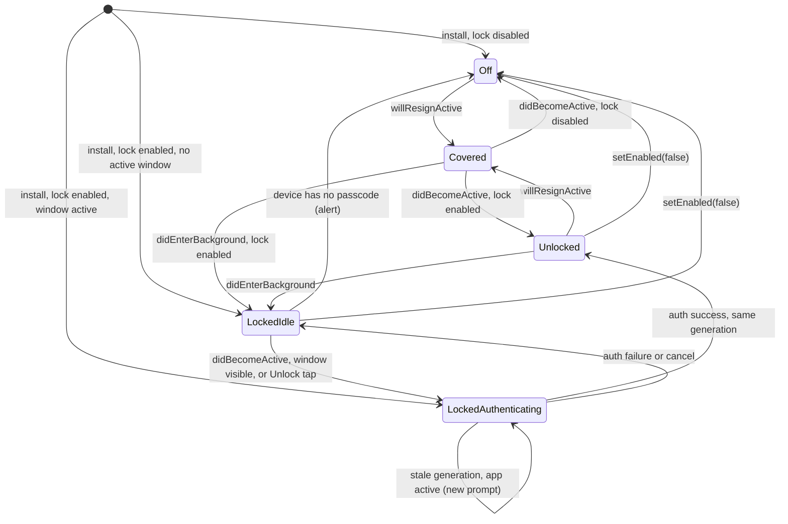

# iOS privacy lock

The privacy lock covers the app window while the app is inactive and, when the user turned the lock on, asks for device authentication before the cover is removed. It lives in the `Track3PrivacyLock` singleton in `src-tauri/gen/apple/Sources/track3/Track3Native.swift`. Rust only forwards three calls (`ios_lock_enabled`, `ios_set_lock_enabled`, `ios_auto_retry_allowed` in `src-tauri/src/app.rs`).

The state is implicit: the `enabled` flag in `UserDefaults`, the booleans `needsUnlock` and `authenticating`, the counter `unlockGeneration`, and whether the cover view is on the window.

| state | `enabled` | `needsUnlock` | `authenticating` | cover |
|---|---|---|---|---|
| `Off` | false | false | false | no |
| `Unlocked` | true | false | false | no |
| `Covered` | any | false | false | yes (app inactive) |
| `LockedIdle` | true | true | false | yes, with an Unlock button |
| `LockedAuthenticating` | true | true | true | yes, system prompt shown |

| event | from | to |
|---|---|---|
| `install`, lock enabled | – | `LockedAuthenticating` if a window is active, else `LockedIdle` |
| `willResignActive` | `Unlocked`, `Off` | `Covered` |
| `didEnterBackground`, lock enabled | any | `LockedIdle`, generation + 1 |
| `didBecomeActive` | `Covered` | `Unlocked` or `Off` |
| `didBecomeActive`, window became visible, or Unlock tap | `LockedIdle` | `LockedAuthenticating` |
| authentication succeeded, same generation | `LockedAuthenticating` | `Unlocked` |
| authentication failed or was cancelled | `LockedAuthenticating` | `LockedIdle` |
| authentication result with a stale generation, app active | `LockedAuthenticating` | `LockedAuthenticating` (new prompt) |
| device has no passcode (`canEvaluatePolicy` is false) | `LockedIdle` | `Off`, with an alert |
| `setEnabled(false)` | any | `Off` |

The generation counter makes a prompt that was answered before the app went to the background unable to unlock the app after it came back.

## Mutation sites (`Track3Native.swift`)

| site | what changes |
|---|---|
| line 27, `install` | `installed`; observers registered once |
| line 34, `install` | `needsUnlock = true` when the lock is enabled |
| line 41, `setEnabled` | `enabled` in `UserDefaults` |
| line 43, `setEnabled(false)` | `needsUnlock = false`, cover removed if active |
| line 92, `background` | `unlockGeneration + 1`, `needsUnlock = true`, cover |
| lines 95-98, `foreground` | cover and prompt, or cover removed |
| lines 100-107, `windowVisible` | cover; prompt if active |
| line 113, `authenticateForeground` | `authenticating = true` |
| line 118, `authenticateForeground` | `authenticating = false`, lock turned off when the device cannot authenticate |
| lines 126-128, completion block | `authenticating = false`; `needsUnlock = false` and cover removed on success |
| lines 55-87, `cover` / `uncover` | the overlay view |

Rust side: `app.rs:379` `ios_lock_enabled`, `app.rs:385` `ios_auto_retry_allowed` (true only when `needsUnlock` is false and the app is active), `app.rs:391` `ios_set_lock_enabled`. The settings toggle goes through `setAppLockEnabled` in `src/utils/ios-native.ts`, which calls `ios_authenticate` first and `ios_set_lock_enabled` second.

`ios_authenticate` (`Track3Native.swift:287`, `app.rs:398`) is a separate blocking prompt with a 90 second timeout. It does not touch the lock state.

## Tests that pin this

Nothing pins the Swift table; it can only be exercised on a device or simulator. `src/utils/ios-native.test.ts` covers the order of the two calls made by the settings toggle.

## Known open defects

- `ios_set_lock_enabled` does not authenticate. Authentication before disabling the lock is enforced only by the caller in `src/utils/ios-native.ts`.
- Suspected: after the user cancels the system prompt, `didBecomeActive` can arrive after the completion block cleared `authenticating`, and `foreground()` prompts again straight away. Needs a device to confirm.
- The lock state cannot be read from Rust or JavaScript, except indirectly through `ios_auto_retry_allowed`.
- Two concurrent `ios_authenticate` calls would show two prompts; the frontend calls it from single user actions.
