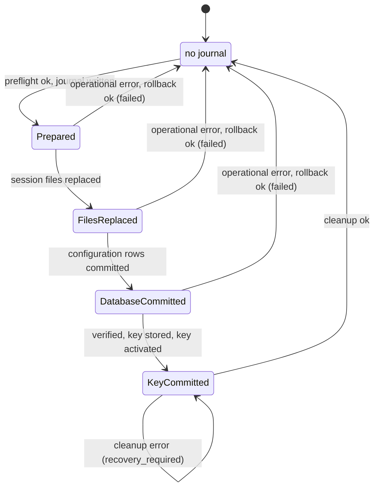
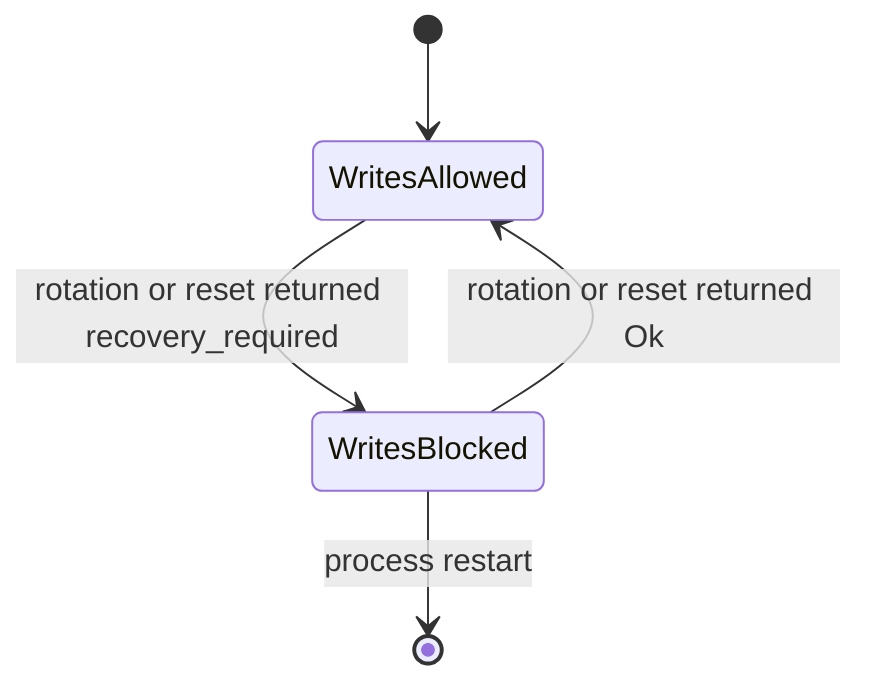

# Encryption key rotation journal and encrypt write gate

Key rotation re-encrypts the encrypted `configuration` rows and the assistant session files under a new key, then replaces the key itself. The code is in `src-tauri/src/key_rotation/`. A journal file (`.ent-key-rotation.json` in the app data directory) makes the operation recoverable after a crash. `ROTATION_MUTEX` (`mod.rs:22`) allows one rotation, reset or recovery at a time in the process.

There are two machines here: the journal on disk, and a small write gate in `Ent` that refuses `encrypt` while a journal is pending.

## Journal on disk

| event | from | to |
|---|---|---|
| preflight ok and journal write | none | `Prepared` |
| session files replaced | `Prepared` | `FilesReplaced` |
| configuration rows committed | `FilesReplaced` | `DatabaseCommitted` |
| new ciphertext verified, key stored, key activated | `DatabaseCommitted` | `KeyCommitted` |
| cleanup ok | `KeyCommitted` | none; the command returns `Ok` |
| cleanup error | `KeyCommitted` | `KeyCommitted`; the command returns `recovery_required` |
| operational error before `KeyCommitted` | any | rollback, then none (`failed`); the journal is kept and the command returns `recovery_required` if the rollback fails |
| startup, or the next rotation, with a journal present | any phase | every step runs again from the top, then cleanup |

**The phase in the journal is a progress marker, not the source of truth.** Resumption does not branch on it. `recover_locked` (`mod.rs:320`) calls `execute_forward` (`mod.rs:391`), which always starts from the first step, and each step re-derives the state of its own target: old content (replace it), new content (already done), or anything else (error). The one place that reads the phase is the rollback decision in `rotate_locked` (`mod.rs:289`): after an operational error at `KeyCommitted` it refuses to roll back. Because recovery rewrites the phase as it goes, a `KeyCommitted` journal can be persisted as `FilesReplaced` again during recovery. That is harmless and expected.

The real state is therefore: journal present or absent, the condition of each target, and the active key in `Ent`.

### Mutation sites

| site | what changes |
|---|---|
| `journal.rs:57` `write`, `journal.rs:70` `stage`, `journal.rs:79` `install_staged` | journal created or replaced |
| `mod.rs:406`, `mod.rs:424`, `mod.rs:438` | `journal.phase` advanced, then persisted |
| `journal.rs:131` `cleanup` | journal removed |
| `files.rs:41` `install_contents`, `files.rs:112` `restore_contents` | one session file moved to new or back to old ciphertext |
| `database.rs:27` `replace_configuration_rows` | configuration rows moved forward or back in one transaction |
| `files.rs:66` `install_key_contents` (desktop), `mod.rs:534` `replace_key_file` (iOS Keychain) | stored key |
| `mod.rs:571` `activate_key`, `mod.rs:605` `restore_key_file`, `mod.rs:353` `align_active_key_for_recovery` | active key in `Ent` (`Ent::change_key`, `ent.rs:116`) |

### Tests that pin this

`src-tauri/src/key_rotation/tests.rs`, in particular `restart_recovers_after_every_durable_phase`, the `restart_recovers_after_*_before_journal_phase` tests, `operational_failures_restore_the_old_consistent_state` and `journal_unlink_failure_after_key_commit_never_rolls_back`. They need the full crate: `cargo test --locked --all-targets key_rotation` from `src-tauri/`.

## Encrypt write gate

A configuration save between a `recovery_required` result and the next restart would change a row the journal still describes, and the next startup recovery would reject it (`database.rs:100`, "configuration row … changed during rotation"), which fails startup. The gate closes that hole in Rust, so a webview reload cannot reopen it.

| event | from | to |
|---|---|---|
| rotation or reset returns `recovery_required` | `WritesAllowed` | `WritesBlocked` |
| rotation or reset returns `Ok` | `WritesBlocked` | `WritesAllowed` |
| rotation or reset returns `failed` (clean rollback, or rejected before it started) | any | unchanged |
| process restart with a successful startup recovery | – | `WritesAllowed` |

While blocked, `Ent::encrypt` (`ent.rs:143`) returns `RECOVERY_REQUIRED_MESSAGE` ("Encryption key recovery is required. Restart Track3 before making further changes."). `encrypt_with_key`, the passphrase export helpers and every decrypt path are not gated, so rotation, rollback, recovery and reading existing data keep working.

### Mutation sites

| site | what changes |
|---|---|
| `ent.rs:93` `block_writes`, `ent.rs:97` `unblock_writes` | the flag |
| `mod.rs:100` `gate_writes` | maps a command result to block, unblock or no change |
| `mod.rs:166` `rotate_encryption_key_for_command`, `mod.rs:177` `reset_encryption_key_for_command`, `mod.rs:261` test wrapper | the only callers of `gate_writes` |

The frontend has the same gate in `src/middlelayers/encryption-write-gate.ts` (`recoveryRequired`), with the same message. It rejects before calling Rust and is lost on a webview reload; the Rust gate is the one that holds.

### Tests that pin this

- `src-tauri/src/ent.rs`: `encrypt_succeeds_after_set_key_and_after_change_key`, `encrypt_is_refused_while_writes_are_blocked_and_decrypt_still_works` (`cargo test --locked -p track3-pure-tests --lib ent::`).
- `src-tauri/src/key_rotation/tests.rs`: `clean_rollback_leaves_encrypt_available`, `recovery_required_blocks_encrypt_until_a_later_rotation_succeeds`.
- `src/middlelayers/encryption-write-gate.test.ts` for the frontend twin.

## Known open defects

- Recovery from `KeyCommitted`, where only cleanup is left, still revalidates every row and session file against the journal. A legitimate write after the commit makes recovery fail. The write gate removes the reachable trigger; skipping revalidation at `KeyCommitted` would be the root fix, and it changes the crash-recovery algorithm.
- A failed startup recovery fails startup (`app.rs:740`, `app.rs:330`). See [startup.md](startup.md).
- There is no command that reports whether a journal is pending; callers learn it from a `recovery_required` error.
- Suspected: `rotate_locked` runs blocking file I/O and Argon2 inside an async command and can hold a runtime worker for seconds when there are many sessions.
