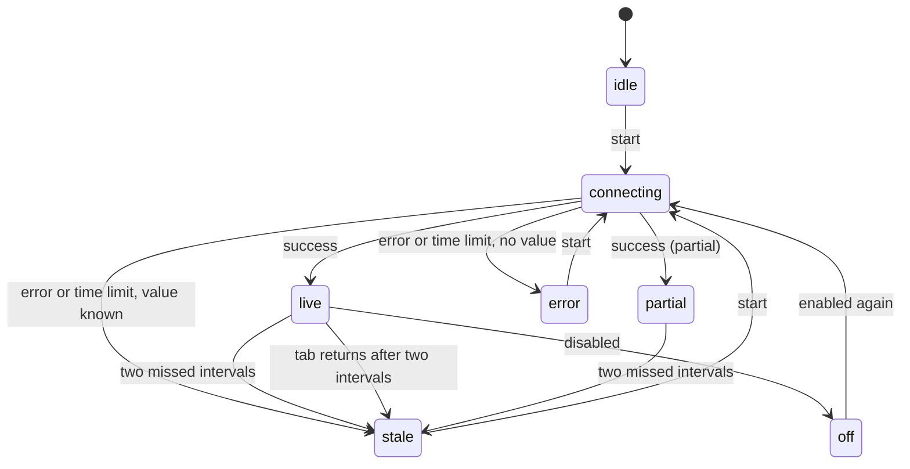

# Live total

The Live total polls the current portfolio value and labels how fresh it is.

- Code: `src/components/use-live-total.ts` (reducer `liveTotalTransition`, hook `useLiveTotal`).
- Views: `src/components/realtime-total-value.tsx` (desktop), `src/mobile/components/mobile/header-total.tsx` (phone), shared text in `src/components/live-total-details.tsx`.
- Value source: `queryRealTimeAssetsValue` in `src/middlelayers/charts-refresh.ts`.

## States

| state | meaning |
|---|---|
| `idle` | nothing asked yet; a value from this session may already be shown |
| `connecting` | a load is running and the shown value is not confirmed |
| `live` | the last load succeeded and every holding was priced |
| `partial` | the last load succeeded but something is missing; `error` holds the reason |
| `stale` | a value is shown but it is old (missed polls, failed load, or the tab was hidden) |
| `error` | no value could be loaded |
| `off` | live polling is disabled, or a one-shot value was loaded |

## Events

| event | from | to |
|---|---|---|
| key change (`reset`) | any | `idle`, value and last success from the session cache |
| `enabled` false | any | `off` |
| `start` (mount, interval tick, retry timer, Retry now, tab visible) | `live`, `partial` | unchanged |
| `start` | anything else | `connecting` |
| `success`, everything priced | any | `live`, last success = now |
| `success`, partial | any | `partial`, last success kept, `error` = reason |
| `success`, stale result (phone falls back to the last snapshot) | any | `stale` |
| `success` with live polling off | any | `off` |
| `error` | value absent | `error` |
| `error` | value present | `stale` |
| load exceeds `timeoutMs` (30 s by default) | any | same as `error`, reason `unknown` |
| stale timer (two intervals after the last success, visible tab) | `connecting`, `live`, `partial` | `stale` |
| tab visible and the last success is older than two intervals | `live`, `partial` | `stale`, then `connecting` on the immediate `start` |
| a failure | n/a | retry after 5 s, 15 s, then every 60 s |

A timed-out load is abandoned, not cancelled: its late answer is ignored.

## Reasons

`LIVE_TOTAL_REASONS` in `use-live-total.ts` is the one list. The value in `error` is a reason, with a count for missing coin prices (`pricesMissing:3`).

| reason | meaning |
|---|---|
| `rateLimited` | a price service answered with a rate limit |
| `pricesMissing` | N held coins have no quote |
| `stockPricesMissing` | the stock quote call failed |
| `rateUnavailable` | a currency rate for broker cash is missing |
| `ibkrToken` | the IBKR token expired |
| `partialSource` | a source reported partial balances in the last refresh |
| `unknown` | anything else, including a load that ran into the time limit |

The coin quote call always asks for USDT and BTC. When it fails and no holding or follow rule needed a coin quote, no `pricesMissing` reason is set. A rate limit is still reported.

## Where to read it

- `data-state` on `.t3-live-amount` and `.t3-live-dot` (both shells).
- A `role="status"` region with `aria-live="polite"` announces the value.
- Failures are logged as `Live total failed: <safe text>`; the text never contains the upstream message.

## Tests

`src/components/use-live-total.test.tsx`, `src/components/live-total-states.test.tsx`, `src/middlelayers/charts-refresh.test.ts` ("live partial prices").
