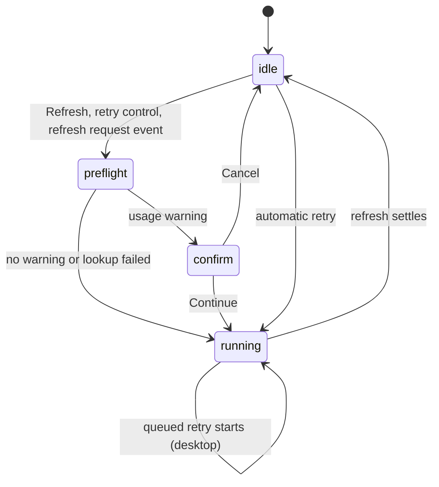

# Refresh flow

A refresh fetches every source, prices the holdings and saves a snapshot. The desktop and phone shells each have their own control with the same flow.

- Controls: `src/components/refresh-data.tsx` (desktop), `src/mobile/components/refresh-data.tsx` (phone).
- Desktop state owner: `RefreshStateProvider` in `src/components/index/index.tsx`. It sits above the top bar, so the loading flag and the progress survive while the top bar is unmounted on the Assistant page.
- Pipeline: `refreshAllData` in `src/middlelayers/charts-refresh.ts`, sources in `src/middlelayers/data.ts`.

## Control states

| state | meaning |
|---|---|
| `idle` | nothing is running |
| `preflight` | the usage lookup before a refresh is running |
| `confirm` | the quota dialog is open and waits for Continue or Cancel |
| `running` | a refresh is running (manual or automatic, full or one source) |

## Events

| event | from | to |
|---|---|---|
| Refresh click, `overview-refresh-request`, `track3:full-refresh-request` | `idle` | `preflight` |
| usage warnings found | `preflight` | `confirm` |
| no warning, or the usage lookup failed | `preflight` | `running` |
| Continue | `confirm` | `running` |
| Cancel | `confirm` | `idle` |
| scheduler tick | `idle` | `running` (automatic, one source) |
| toast Retry while running (desktop) | `running` | `running`, one retry queued |
| refresh settles, any outcome | `running` | `idle`, or `running` when a retry is queued |
| any trigger | not `idle` | ignored |
| top bar unmounts or mounts (desktop) | `running` | `running`; the new control is disabled and shows the progress |
| refresh settles while the top bar is unmounted or remounted | `running` | `idle`; the live control adopts the statuses and the last result |

## Single-source retry

A retry of one source needs the per-source results of the last refresh. That capability is on when the last result has `sourceResults`.

| event | from | to |
|---|---|---|
| refresh returns a result | `running` | `idle`, capability on |
| `FullRefreshRequiredError` (the configuration or the snapshot changed) | `running` | `idle`, scheduler `stopped`, capability off |
| any Retry control while the capability is off | `idle` | `preflight` for a full refresh |
| app restart | n/a | capability off; stored statuses are still shown |

## Pipeline phases

| phase | what happens | progress |
|---|---|---|
| query | sources are fetched in parallel, then prices | 5 to 75 %, then to 90 % |
| generation check | a configuration change during the query starts the query again | n/a |
| prepare | inside the write queue: merge with the baseline and freeze the rows to save | n/a |
| persist | write the snapshot; a retry of this phase reuses the frozen rows | to 100 % |

The price step has a time limit of 60 s (`queryCoinPrices` in `data.ts`). When it is exceeded the attempt fails with "Price query timed out" and the caller's retry policy applies: a manual refresh tries 3 more times 3 s apart and then shows the "unexpected error" notice; an automatic retry is rescheduled.

The outcome is three flags on the result: `requiresDataSourceAction`, `usedLastKnownData`, `persisted`.

| outcome | flags |
|---|---|
| saved, complete | `persisted` not false, others false |
| saved with last known values for failed sources | `usedLastKnownData` true |
| not saved, every source failed | `requiresDataSourceAction` true |
| not saved, the retried source still fails | `persisted` false |

## Where to read it

- `data-state` on the refresh button (`.t3-refresh-button`, and `.t3-refresh-progress-pill` on the desktop Overview).
- A `role="status"` region says "Refreshing portfolio" while `preflight` or `running`.
- Per-source rows carry `data-source-status-row`; see [Source status](source-status.md).

## Tests

`src/components/refresh-data.test.tsx`, `src/mobile/components/refresh-data.test.tsx`, `src/components/index/index-refresh-assistant.test.tsx`, `src/components/refresh-duplicate-fetch.test.tsx`, `src/middlelayers/data-coin-prices.test.ts`.
