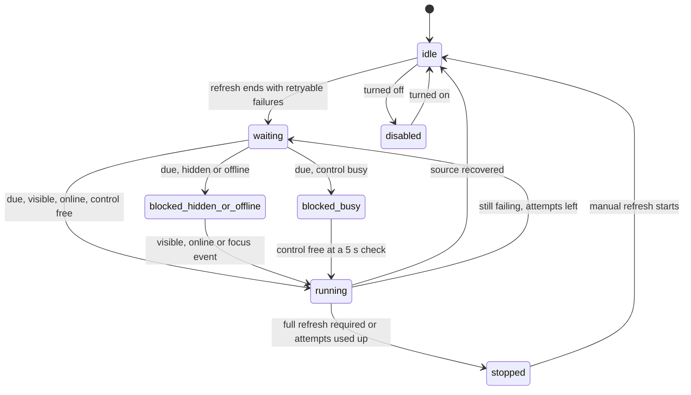

# Automatic retry scheduler

After a refresh the scheduler retries each failed source on its own: 60 s after the failure, then 5 min, then 15 min.

- Code: `RefreshRetryScheduler` in `src/middlelayers/refresh-retry-scheduler.ts`. One instance, `refreshRetryScheduler`, is bound to the mounted refresh control by `bindRefreshRetry`.

## States

| state | meaning |
|---|---|
| `disposed` | no refresh control is mounted; nothing runs |
| `disabled` | the user turned automatic retries off |
| `idle` | no source is waiting for a retry |
| `waiting` | a timer runs to the next due time |
| `blocked-hidden-or-offline` | a retry is due but the window is hidden or offline; it waits for an event |
| `blocked-busy` | a retry is due but a refresh or preflight is running; it checks again every 5 s |
| `running` | one source is being retried |
| `stopped` | retries ended: a full refresh is required, or a source used its 3 attempts and nothing else is waiting |

## Events

| event | from | to |
|---|---|---|
| `complete(statuses)` with retryable failures | `idle` | `waiting`, first try 60 s after the source finished |
| timer, `visibilitychange`, `online`, `focus` | `waiting`, due | `running`, `blocked-hidden-or-offline` or `blocked-busy` |
| run returns statuses, source recovered | `running` | `idle` or `waiting` |
| run returns statuses, still failing | `running` | `waiting` (5 min, then 15 min); dropped after attempt 3 |
| run returns `undefined` (the app paused it) | `running` | `waiting` 5 s, attempt not counted |
| run returns `null` (retry inputs are gone) | `running` | entry dropped |
| `FullRefreshRequiredError` | `running` | `stopped` |
| last entry dropped with an exhausted source | `running` | `stopped` |
| `manualStart()` | any | `idle` |
| `setEnabled(false)` / `setEnabled(true)` | any | `disabled` / previous, attempts kept |

Retryable categories are network, service, rate limit and other. Quota and auth failures are never retried automatically.

## Where to read it

The snapshot (`refreshRetryScheduler.status()`) has `enabled`, `stopped` and `nextBySource`. Both refresh controls map it to `data-retry-state` on their `role="status"` element:

| `data-retry-state` | scheduler states |
|---|---|
| `off` | `disabled` |
| `idle` | `idle` |
| `waiting` | `waiting`, `blocked-hidden-or-offline`, `blocked-busy`, `running` |
| `stopped` | `stopped` |

While `disposed` no refresh control is mounted, so there is no attribute to read.

The source status dialog shows "Next automatic try at" for `waiting` and "Automatic retries stopped" for `stopped`. The snapshot does not say why it stopped.

## Tests

`src/middlelayers/refresh-retry-scheduler.test.ts`, and "reports the refresh and automatic retry states as data attributes" in both refresh control tests.
