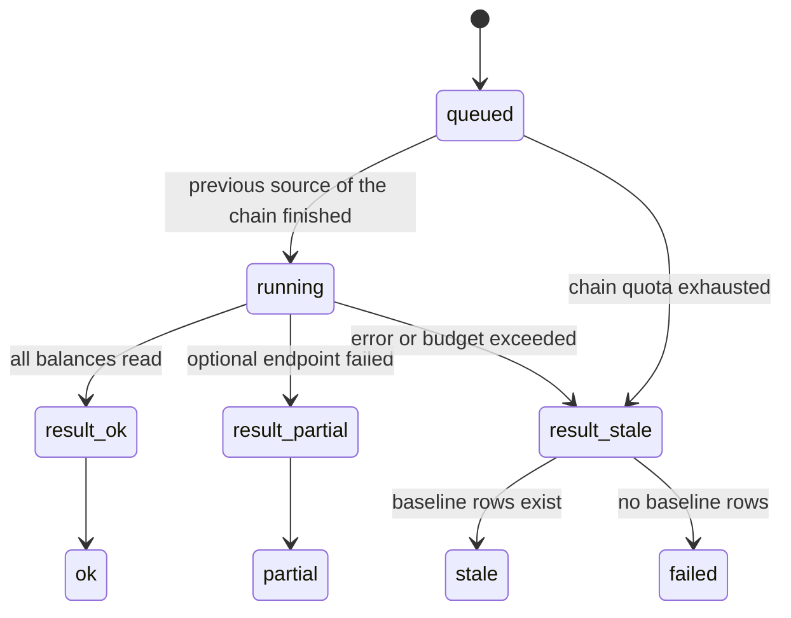

# Source status

Each configured source (an exchange, a wallet, a broker, the manual list) is fetched on its own. Two vocabularies describe the outcome, and the same word means different things in them.

- Fetch: `fetchPortfolios` in `src/middlelayers/data.ts`.
- Mapping to the stored status: `refreshAllData` in `src/middlelayers/charts-refresh.ts`.
- Types: `PortfolioSourceResult` and `PortfolioSourceStatus` in `src/middlelayers/portfolio-baseline.ts`.
- Storage: `src/middlelayers/ui-state/source-status-store.ts`.

## Fetch lifecycle (one source)

| step | meaning |
|---|---|
| queued | waits for the previous source of the same chain, plus 1 s for BTC, DOGE, TON, ERC20 and TRC20 |
| running | 30 s budget; 120 s for exchanges, SOL, ERC20 and brokers |
| result `ok` | every balance was read |
| result `partial` | balances were read but an optional endpoint failed |
| result `stale` | the fetch failed; `category` and `detail` say why |

A quota error marks the chain as exhausted, so later wallets of that chain end as `stale` with category quota without a request. A source that runs into its budget is not cancelled; its late answer is ignored.

## The two vocabularies

| `PortfolioSourceResult.status` (fetch) | `PortfolioSourceStatus.status` (stored, shown) | rule |
|---|---|---|
| `ok` | `ok` | n/a |
| `partial` | `partial` | n/a |
| `stale` | `stale` | the last snapshot has rows for this source, so old values are shown |
| `stale` | `failed` | the last snapshot has no rows for this source |

So `stale` means "the fetch failed" in a result and "showing old rows" in a status.

A failed single-source retry that is not saved uses a second rule: the status is the previous status of that source, or `failed` when there is none.

## Events

| event | from | to |
|---|---|---|
| refresh saved | any | statuses replaced by the mapping above |
| single-source retry saved | that source | new status; other sources keep theirs |
| single-source retry not saved | that source | previous status, else `failed` |
| source renamed in settings | any | same status, new label |
| app restart | any | statuses read from storage; single-source retry is off until the next refresh |

## Where to read it

- Stored list: `readStoredStatuses()`; changes are announced with the `source-statuses-changed` window event.
- Rows in the status dialog carry `data-source-status-row`; the status pill has `data-tone` (`ok`, `warn`, `err`).
- The source status button has `data-tone` for the worst status.

## Tests

`src/middlelayers/data-source-fallback.test.ts`, `src/middlelayers/refresh-sources.test.ts`, `src/middlelayers/charts-refresh.test.ts` ("partial source snapshots").
