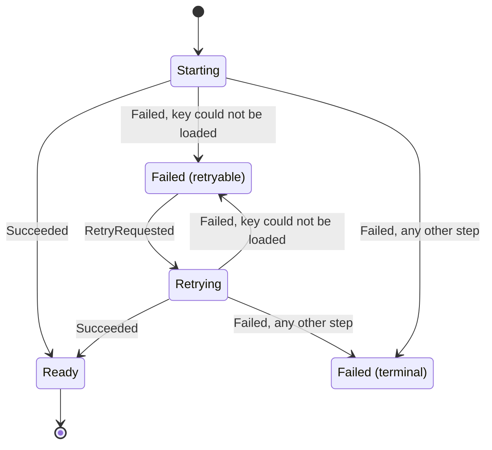
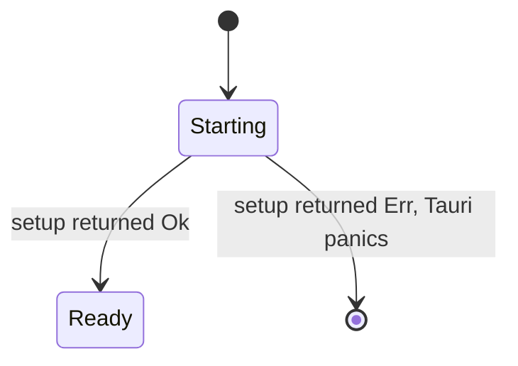

# App startup (desktop and iOS)

Startup runs once inside the Tauri setup closure in `src-tauri/src/app.rs` (`run`). The steps, in order: instance lock → (iOS: native install, backup bookmark restore, key artifact exclusion) → resolve database path → load key → initialise database → set key → recover a pending key rotation → migrate → (desktop: grant the saved backup folder) → manage `DatabasePath`.

On iOS the result is an explicit state in `src-tauri/src/startup_state.rs`, held in one static (`IOS_STARTUP_STATE`, `app.rs:45`). On desktop there is no state: setup returns the error and the process ends.

## iOS

| event | from | to |
|---|---|---|
| `Succeeded` | `Starting`, `Retrying` | `Ready` |
| `Failed { message, retryable }` | `Starting`, `Retrying` | `Failed { message, retryable }` |
| `RetryRequested` | `Failed` with `retryable: true` | `Retrying` (keeps the message) |
| `RetryRequested` | `Failed` with `retryable: false`, `Retrying`, `Ready`, `Starting` | unchanged; `ios_retry_startup` returns `false` |
| anything else | any | unchanged |

`transition(state, event)` returns `None` for every row marked unchanged, and `dispatch` leaves the static alone in that case.

### Commands

| command | result |
|---|---|
| `ios_startup_failure` | The message while `Failed` or `Retrying`, otherwise `null`. |
| `ios_startup_status` | `{ "state": "starting" \| "ready" \| "failed" \| "retrying", "message"?, "retryable"? }`. `message` is present for `failed` and `retrying`, `retryable` only for `failed`. |
| `ios_retry_startup` | `true` when the retry reached `Ready`. `false` when the retry was refused or failed; read `ios_startup_status` to tell which. |

The message is the developer error string of the failed step (for example `iOS Keychain read failed (OSStatus -25308)`). These messages carry paths and OS status codes; the key loading and rotation recovery steps do not put key values into their errors.

### Mutation sites

| site | event |
|---|---|
| `app.rs:719` setup, `load_or_create_ios_encryption_key` failed | `Failed`, retryable |
| `app.rs:766` setup, after `DatabasePath` is managed | `Succeeded` |
| `app.rs:775` setup, any other error | `Failed`, terminal |
| `app.rs:347` `ios_retry_startup` | `RetryRequested` |
| `app.rs:352` `ios_retry_startup`, `retry_ios_startup` returned `Ok` | `Succeeded` |
| `app.rs:356` `ios_retry_startup`, `retry_ios_startup` returned an error | `Failed`; retryable only for the key load step (`app.rs:301-342`) |
| `app.rs:360` `ios_retry_startup`, the blocking task panicked | `Failed`, terminal |

All of them go through `dispatch` (`startup_state.rs`); `set_ios_startup_failure` (`app.rs:50`) is the `Failed` wrapper.

### Frontend gate

`src/mobile/components/ios-startup-gate.tsx` keeps the portfolio unmounted until startup is `Ready`. Its root element carries `data-state`:

| `data-state` | meaning | Retry button |
|---|---|---|
| `checking` | first status request is pending (`aria-busy="true"`) | not rendered |
| `failed-retryable` | backend is `Failed` with `retryable: true` | enabled |
| `failed-terminal` | backend is `Failed` with `retryable: false` | visible, disabled |
| `retrying` | backend reported `Retrying` | enabled |
| `locked` | startup failed or is unknown, and `ios_startup_status` could not be read | enabled |

When the gate is ready it renders its children and no element of its own. The locked screen is `role="alert"` and shows the failure message under the fixed copy. Window focus and `visibilitychange` to visible call the same retry as the button.

### Tests that pin this

- `src-tauri/src/startup_state.rs`, module `tests`: one test per table row, the serialised shape, and `dispatch`. Run with `cargo test --locked -p track3-pure-tests --lib startup_state` from `src-tauri/`.
- `src/mobile/components/ios-startup-gate.test.tsx`: lock, reason, disabled Retry, `data-state`, fallback when the status command is missing.
- `tests/e2e/fidelity-flows.spec.ts`, "native keychain startup failure stays locked and offers its real retry": the Retry button stays visible.

The `cfg(target_os = "ios")` wiring in `app.rs` compiles only for the iOS target, which CI builds on macOS.

## Desktop

| event | from | to |
|---|---|---|
| setup ok | Starting | Ready (`DatabasePath` managed at `app.rs:730`, key set at `app.rs:738`) |
| any setup error | Starting | process exit, no window |

Nothing pins the desktop table.

## Known open defects

- Desktop: any setup error ends the process with no window and no reason (second instance, database newer than the app, two valid databases, failed rotation recovery). The fix is a desktop startup gate built on `StartupState`; it needs a real window to verify.
- iOS: every key provisioning error is marked retryable (`app.rs:719`, `app.rs:320`), including permanent ones such as "iOS Keychain and legacy key file differ". Retry stays enabled for those; the reason is shown.
- iOS: the fixed lock copy tells the user to unlock the phone, which is wrong advice for a terminal failure. The reason below it is correct.
- No Rust logger is installed, so `log::warn!` and `log::debug!` calls in `app.rs` produce no output.
- Suspected: migrations run under `block_on` on the main thread during setup; a long migration on iOS could exceed the launch watchdog.
