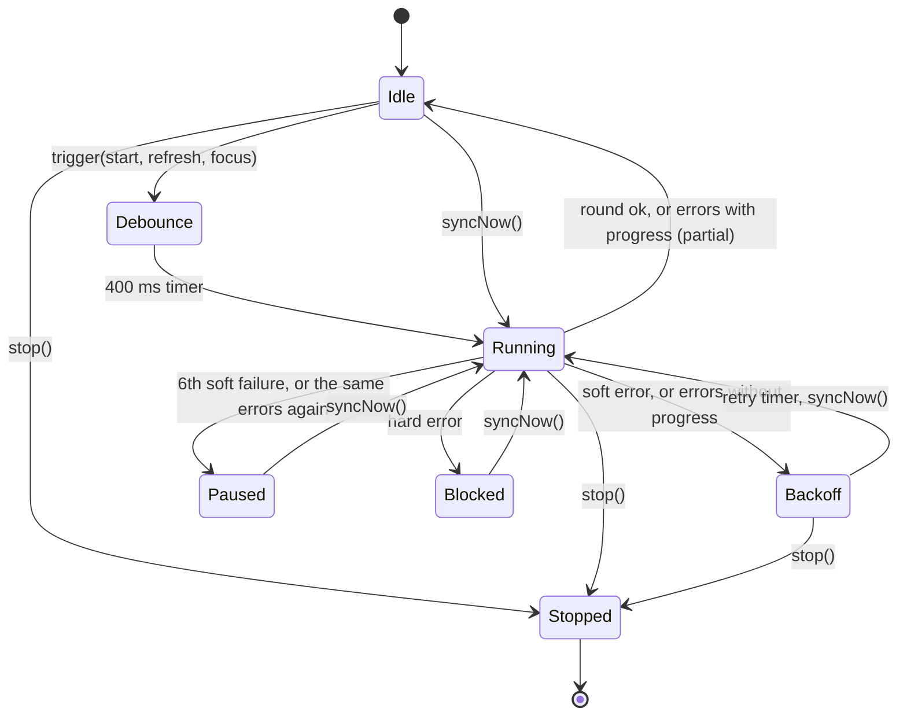
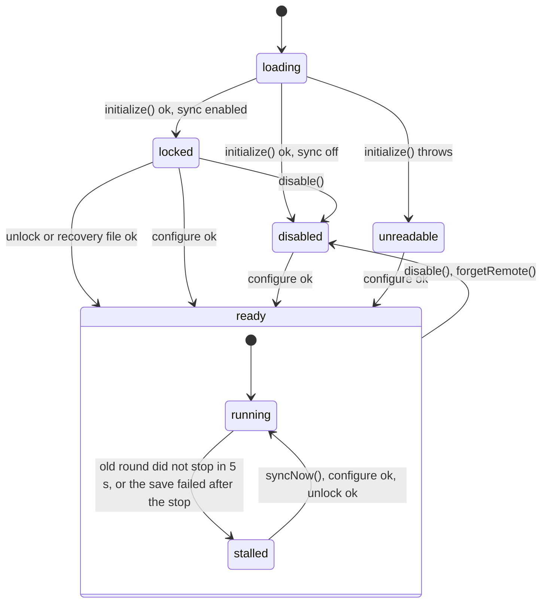
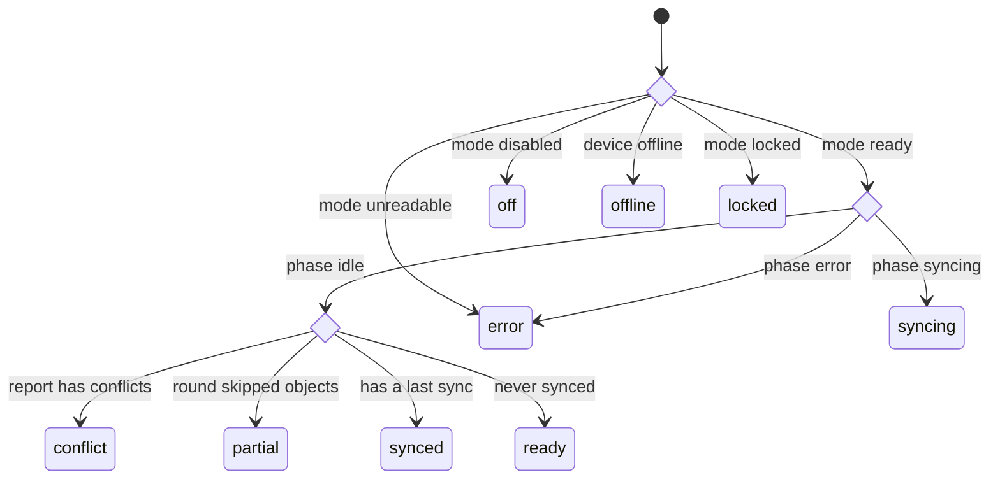
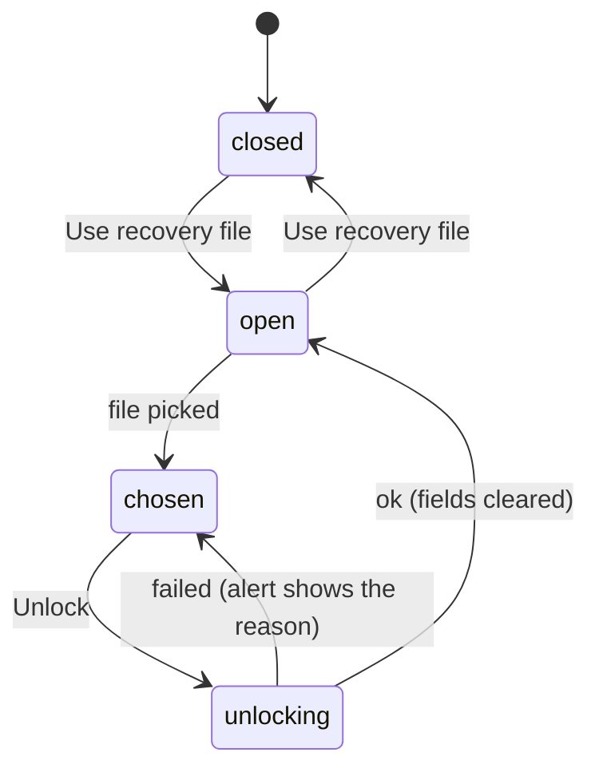
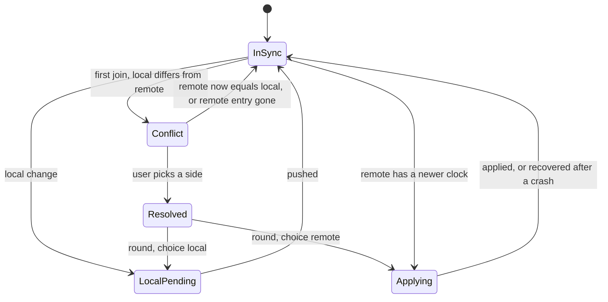

# Sync state machines

Sync has four machines worth knowing before you change it: the scheduler (rounds and retries), the runtime (mode), the badge (what every surface shows) and the per-setting config conflict. Each section gives the states, the events, the one place that changes the state, and what a test can read. Protocol and bucket layout are in [`docs/sync.md`](../sync.md).

## What a test can read

| attribute | element | values |
|---|---|---|
| `data-mode` | root of the sync settings page (`.sync-settings-page`) | `loading`, `disabled`, `locked`, `ready`, `unreadable` |
| `data-busy` | same element | empty when idle, else the running action: `test`, `save`, `unlock`, `now`, `disable`, `forget`, `rename-<device id>`, `conflict-<config id>-<local or remote>` |
| `data-sync-state` | top bar sync button (`.t3-topbar-sync-button`) | `off`, `offline`, `error`, `conflict`, `partial`, `locked`, `syncing`, `synced`, `ready` |
| `data-sync-retry` | same button, only when the state is `error` | `scheduled`, `stopped`, `blocked` |

The top bar also holds a `role="status"` `aria-live="polite"` line with the same state in words. Wait for `data-busy=""` instead of sleeping after an action.

## Scheduler: rounds and retries

`SyncScheduler` in `src/middlelayers/sync/scheduler.ts`. Every status change goes through `setStatus` (`src/middlelayers/sync/scheduler.ts:83`); the fields behind it are private.

| state | how the code encodes it |
|---|---|
| Idle | `phase: "idle"`, no timer, no current run. `partial: true` when the round skipped objects or had non-fatal errors |
| Debounce | timer set, 400 ms |
| Running | current run and abort controller set, `phase: "syncing"`; `pending` when another round was asked for |
| Backoff | `phase: "error"`, soft error, timer set, `nextRetryAt`, `failures` 1 to 5 |
| Paused | `phase: "error"`, `retryStopped: true`, no timer |
| Blocked | `phase: "error"`, a hard error (`isHardSyncError`: `header`, `passphrase`, `access`, `configuration`), no timer |
| Zombie | the round timed out but its promise has not settled; overlaps Backoff |
| Stopped | terminal. The status keeps its last value and nothing runs again |

| event | from | to |
|---|---|---|
| `trigger(start or refresh)` | Idle, Debounce | Debounce (timer restarted) |
| `trigger(*)` | Running | Running, `pending` set |
| `trigger(*)` | Backoff, Paused, Blocked, Stopped | ignored |
| `trigger(focus)` | any | as above, at most once per 60 s |
| `syncNow()` | any but Running, Zombie, Stopped | failure count reset, Running |
| `syncNow()` | Running | joins the current round |
| `syncNow()` | Zombie | `pending` set, returns at once |
| round ok, or errors with progress | Running | Idle; the saved retry state is cleared; Running again if `pending` |
| errors without progress, or a deferred config decision | Running | Backoff; Paused when the errors equal the previous round's |
| throw, soft (`network`, `timeout`, `bucket`, `conditions`) | Running | Backoff after 5 s, 30 s, 2 min, 10 min, 30 min (each ±20 %); Paused on the 6th |
| throw, hard | Running | Blocked |
| watchdog: 3 min without activity, or 6 h in total | Running | abort, Backoff with `timeout`, Zombie until the run settles |
| stale run settles | Zombie | Running if `pending` |
| `stop()` | any | Stopped; resolves `false` when the run has not settled within 5 s |
| constructor with a saved retry state | start | Backoff (remaining wait), Paused (recent), or Idle with one probe round left |

Only Sync now, a settings change or a successful round ends Paused and Blocked. Nothing wakes the scheduler on `online` or `visibilitychange`.

## Runtime: mode

`SyncRuntime` in `src/middlelayers/sync/runtime.ts`. The published snapshot changes only in `publish` (`src/middlelayers/sync/runtime.ts:98`). `stall` (`src/middlelayers/sync/runtime.ts:104`) is the one place that enters the stalled state.

| event | from | to |
|---|---|---|
| `initialize()` ok | loading | locked (enabled) or disabled |
| `initialize()` throws | loading | unreadable |
| `skip()` | locked | locked, `skipped: true` |
| `unlock` / `unlockRecoveryFile` ok | locked | ready, new scheduler, `trigger("start")` |
| `configure` ok | any | ready |
| `configure` fails before it stops the round | any | unchanged, the result is returned |
| `configure` / `unlock*`: old round not settled in 5 s | ready | ready, stalled: `{ phase: "error", error: "timeout", retryStopped: true }` |
| `configure`: round stopped, then the settings write or state reset throws | ready | ready, stalled: `{ phase: "error", error: <classified>, retryStopped: true }` |
| either of the two rows above while sync is disabled and its last round is still draining | disabled | disabled, the result is returned, nothing is published |
| `syncNow()` | ready, stalled | ready: a new scheduler on the same engine, then a round |
| scheduler status change | ready | ready, republished |
| `disable()` | any | disabled; resolves `false` while the old round is still draining |
| `forgetRemote()` | any | disabled, then remote delete, then local reset |
| `stop()` | any | fields cleared, snapshot untouched (unmount and `beforeunload` only) |

Stalled exists because a stopped scheduler ignores every trigger. `retryStopped: true` makes the surfaces say "Needs attention" and offer Sync now, and Sync now then really restarts sync with the settings that were in use.

Device list (`devices()`): `publish` keeps the last device list it saw in a report, because a round that throws publishes no report.

| event | device list |
|---|---|
| a status whose report has devices is published | replaced |
| round fails by throwing | kept |
| `configure` / `unlock*` ok (new engine) | cleared |
| `disable()` / `forgetRemote()` | cleared |

## Badge: what the surfaces show

`syncBadge` in `src/middlelayers/ui-state/sync-badge.ts` (`src/middlelayers/ui-state/sync-badge.ts:23`) is a pure function of the runtime status and `navigator.onLine`. The top bar button, the wide popover, the phone sheet, the settings status card and the phone status button all take the state and the retry kind from it; they read the raw status only for details such as progress and counts. First matching row wins.

| input | badge | `data-sync-retry` | pill |
|---|---|---|---|
| mode `disabled` | `off` | | |
| device offline | `offline` | | |
| mode `unreadable` | `error`, reason `unreadable` | `blocked` | Needs attention |
| mode `locked` | `locked` (`skipped` from the runtime) | | Passphrase needed |
| `syncing` | `syncing` (direction from the progress) | | Downloading / Uploading |
| `error`, `retryStopped` | `error` | `stopped` | Needs attention |
| `error`, hard reason | `error` | `blocked` | Needs attention |
| `error`, otherwise | `error` | `scheduled` | Retrying |
| idle, report has conflicts | `conflict` | | Needs attention |
| idle, `partial` | `partial` | | Needs attention |
| idle, report has errors but no `partial` | `error`, reason `sync` | `scheduled` | Retrying |
| idle with `lastSync` | `synced` | | Synced |
| idle without `lastSync` | `ready` | | Never synced |

Notes:

- "Retrying" is shown only when a retry is really scheduled. `stopped` and `blocked` wait for the user.
- The scheduler never produces the "idle with errors but no `partial`" row; it stays because `src/components/sync-status-model.test.tsx` pins it.
- While offline the button shows `offline`, and the popover keeps describing the last known state.
- Two surface rules sit in `src/components/sync-status-indicator.tsx`, next to the pills: the wide popover says "Synced" once it has a report, and the phone sheet keeps the plain synced pill for conflicts because it lists them in its details.
- `syncBadgePhase` maps a badge to the `sync.status.*` catalog suffix; `syncBadgePill` maps it to the pill. Both are exhaustive switches, so a new badge state fails the type check until every surface handles it.

## Recovery file unlock

`SyncRecoveryUnlock` in `src/components/settings/sync-recovery.tsx`.

| result of the unlock | alert |
|---|---|
| `ok` | none; the file and its passphrase are cleared |
| `passphrase` | the recovery file, passphrase or bucket did not match |
| `network`, `timeout`, `access`, `bucket`, `header`, `configuration`, `conditions` | the matching `sync.connection.*` text |
| the call throws | the generic did-not-match text |

## Config conflict (per synced setting)

Kept per config id in the local `sync_state` row (never on the wire). All transitions happen inside a sync round in `src/middlelayers/sync/engine.ts`, except the user's choice.

| state | how the code encodes it |
|---|---|
| InSync | `config[id].hash` equals the local hash |
| LocalPending | `pendingConfig[id]` |
| Conflict | `configConflicts[id] = token` |
| Resolved | `configResolutions[id] = { token, choice }` |
| Applying | `applyingConfig[id]` (write-ahead marker) |
| Deferred | round-local `configDecisionDeferred`: a manifest or config read failed, so the round decides nothing and the scheduler retries |

| event | from | to | code |
|---|---|---|---|
| first join, local differs from remote | none | Conflict | `engine.ts:942-953` |
| user picks a side (`resolveConfigConflict`) | Conflict | Resolved | `engine.ts:388-397` |
| round, choice local | Resolved | LocalPending | `engine.ts:954-960` |
| round, choice remote | Resolved | Applying, then InSync | `engine.ts:1183`, `engine.ts:1202-1230` |
| remote value now equals local, or the remote entry is gone | Conflict | InSync | `engine.ts:928-935` |
| crash during apply | Applying | InSync on the next round | `engine.ts:717-728` |
| remote has a newer clock | InSync | Applying, then InSync | `engine.ts:1194-1203` |
| manifest or config read failed | no marker | Deferred | `engine.ts:937-940`, `engine.ts:1189-1193` |
