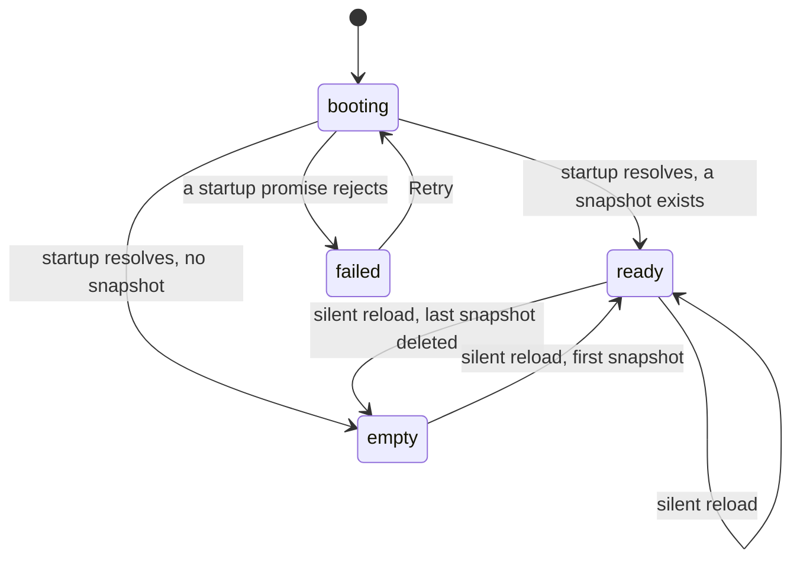
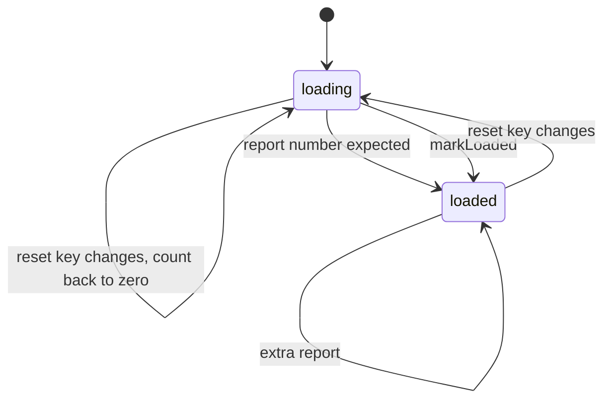
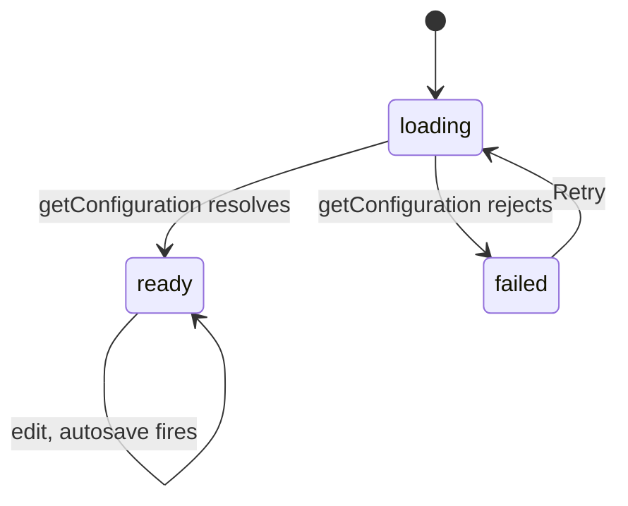
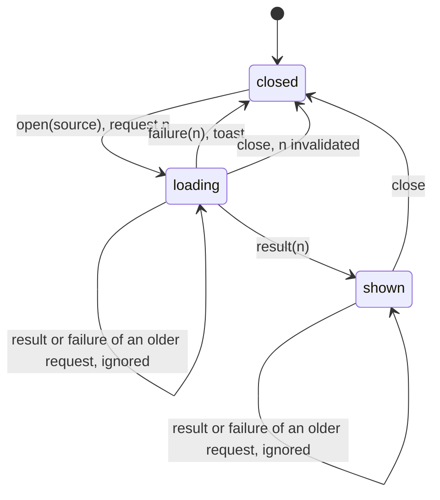
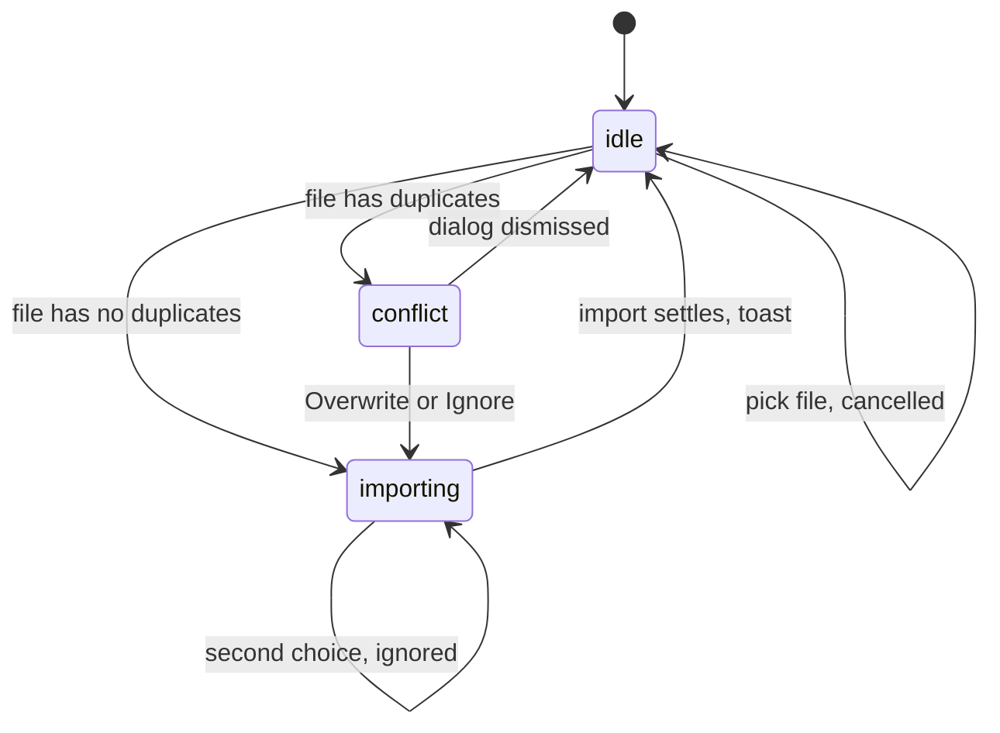
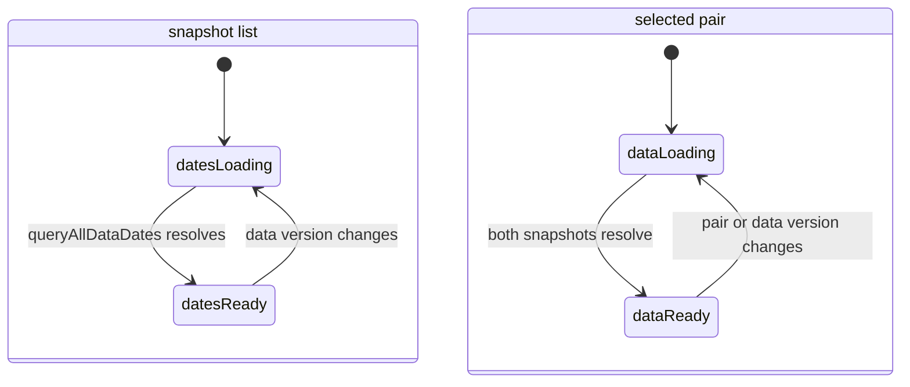
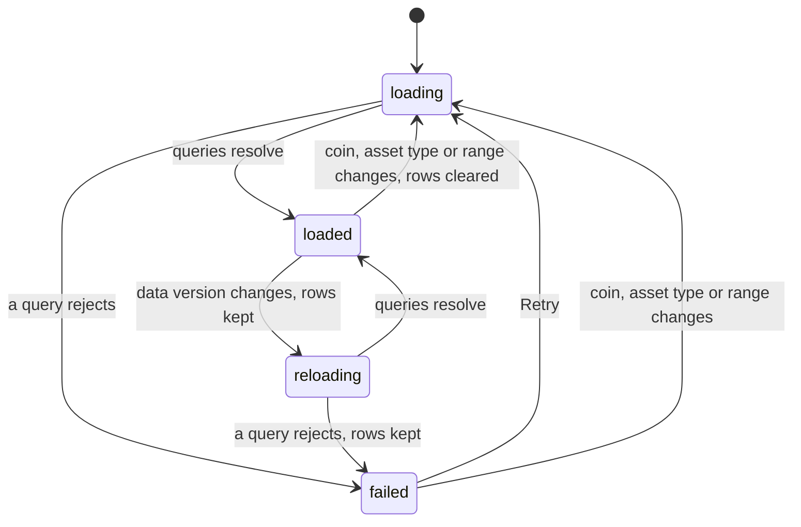

# Desktop UI state machines

Machines under `src/components/` that expose their state to tests and agents. The shared conventions are in [README.md](README.md). These rules apply to the machines in this file as well:

- Each machine gets one section: where the state lives, the diagram, the events table, where the state is exposed in the DOM, and the tests that pin it.
- Expose the state as `data-state="<state>"` on the element that already carries `aria-busy` for that machine. Values are the state names from the table, lower-case with hyphens, never translated copy. Radix primitives own `data-state` on their own elements (dialog content, switches); put the attribute on a child there.
- A failed step is its own state. It must look different from "empty" and from "finished", and the reason shown to the user goes through `redactSecrets`.
- Tests wait on the attribute or on a role, with fake timers or controlled promises. They do not sleep.

| machine | file | DOM marker |
|---|---|---|
| [App boot](#app-boot) | `index/index.tsx` | `data-boot-state` on `.t3-desktop-shell` |
| [Section load gate](#section-load-gate) | `use-section-load-gate.ts` | `data-state` on each page root |
| [Configuration form load](#configuration-form-load) | `configuration/index.tsx` | `data-state` on the page root |
| [Quick Look](#quick-look) | `configuration/index.tsx` | dialog `role="dialog"`, spinner `role="status"` |
| [Legacy import](#legacy-import) | `data-management.tsx` | `data-state` on `import-conflict-choices` |
| [Comparison loaders](#comparison-loaders) | `comparison.tsx` | `data-state` on `.analyze-comparison` |
| [Coin page loader](#coin-page-loader) | `coin-analytics.tsx`, `coin-fidelity-view.tsx` | `data-state` on `.coin-fidelity` |

## App boot

State lives in `App` (`hasData`, `initializing`, `loadError`) and is named once in `Layout` as `bootState`.

| event | from | to |
|---|---|---|
| mount | - | `booting` |
| startup promises resolve | `booting` | `ready` or `empty` (by `queryLastRefreshAt`) |
| any startup promise rejects | `booting` | `failed` (reason is sanitized, at most 300 characters) |
| Retry click | `failed` | `booting` |
| data changed, soft refresh event, refresh success | `ready`, `empty` | `ready`, `empty` (silent reload, no intermediate state) |

- DOM: `data-boot-state="booting|ready|empty|failed"` on `.t3-desktop-shell`. The inner content div keeps `aria-busy`, and the failure card keeps `role="alert"`.
- Test: `index/index-data-changed.test.tsx`, "names the boot state on the shell".
- Open questions, not changed here:
  1. A failed silent reload is only logged (`data reload failed`). The user keeps the old dates with no sign of the failure.
  2. Silent reloads have no generation guard, so an older reload can in theory land after a newer one.
  3. Boot has no timeout. A startup promise that never settles leaves `booting` forever.

## Section load gate

`useSectionLoadGate(expected, resetKey, enabled = true)` owns the boolean, the report counter and the reset. Overview (3 sections), Summary (6), Wallets (2) and the Coin page (1 in the fidelity layout, 3 in the legacy one) use it. Sections report through `OverviewLoadingContext`.

| event | from | to |
|---|---|---|
| mount, reset key change (`enabled`) | any | `loading`, count 0 |
| mount, reset key change (not `enabled`) | any | `loaded` |
| `reportLoaded()` | `loading` (n) | `loading` (n + 1), or `loaded` when n + 1 = `expected` |
| `reportLoaded()` | `loaded` | `loaded` |
| `markLoaded()` | any | `loaded` |

- The reset key is the date range plus the data-changed version (the Coin page adds symbol, asset type and its retry counter).
- `enabled = false`: Summary with an invalid range renders no section, so the gate stays open.
- `markLoaded`: the wide Wallets layout loads as one unit and reports once; the Coin page opens the gate after 8 seconds if its load never reports.
- There is no `failed` state at the gate. A section that fails still reports, and shows its own empty or error state.
- `expected` must equal the number of sections that report. A larger number leaves the page in `loading`.
- DOM: `data-state="loading|loaded"` next to `aria-busy` on the page root (`.analyze-summary`, `.analyze-wallets`, the Overview root, the legacy `.analyze-coin` root).
- Tests: `use-section-load-gate.test.ts`, `page-shell-loading.test.tsx`, `overview-loading.test.tsx`, `profit-loading.test.tsx`, `wallets-fidelity.test.tsx`, `summary-profit-loss.test.tsx`.
- The mobile pages under `src/mobile/components/` still carry their own copies of this gate.

## Configuration form load

State lives in `loadState` (`"loading" | "ready" | "failed"`) and `loadFailure` (the redacted reason) in `configuration/index.tsx`.

| event | from | to | save allowed |
|---|---|---|---|
| mount, Retry | -, `failed` | `loading` | no |
| load resolves | `loading` | `ready` | yes |
| load rejects | `loading` | `failed` | no |
| edit | `ready` | `ready` (save fires) | yes |
| edit | `loading` | `loading` (nothing is written) | no |

- `submitConfiguration` returns at once unless the state is `ready`. A form that never loaded holds empty lists, and saving it would replace every stored exchange, wallet, broker and custom asset.
- `failed` renders an alert with the reason and a Retry button instead of the sections, so there is nothing to edit.
- DOM: `data-state="loading|ready|failed"` on the page root; the failure card has `role="alert"`.
- Tests: `configuration/load-failure.test.tsx`.
- The phone copy (`src/mobile/components/configuration/index.tsx`) has not been checked for the same branch.

## Quick Look

Three handlers (exchange, wallet, broker) share `quickLookOpen`, `quickLookLoading`, `quickLookData` and `quickLookTitle`. `quickLookRequest` (a counter ref) names the request on screen.

| event | from | to |
|---|---|---|
| open a source | `closed` | `loading` (request n) |
| result for n | `loading` | `shown` |
| failure for n | `loading` | `closed`, destructive toast with the redacted reason |
| close | `loading`, `shown` | `closed`; n is invalidated |
| result or failure for m ≠ n | any | unchanged, no toast |

- A wallet Quick Look on ERC20 or TRC20 still invalidates the Pro usage cache when its request is stale, because the quota was spent.
- DOM: the dialog is named `Quick Look - <title>`; while loading it contains `role="status"`.
- Tests: `configuration/quick-look-race.test.tsx`, `configuration/quick-look-quota.test.tsx`.

## Legacy import

The Import button of the narrow Backup layout. State lives in `exportData`, `showConflictResolverDialog` and `importBusy` in `data-management.tsx`.

| event | from | to |
|---|---|---|
| Import click, file read fails or duplicate check fails | `idle` | `idle`, destructive toast with the redacted reason |
| Import click, no duplicates | `idle` | `importing` |
| Import click, duplicates | `idle` | `conflict` (dialog) |
| Overwrite or Ignore | `conflict` | `importing` |
| Overwrite or Ignore | `importing` | ignored (buttons are disabled) |
| import resolves or rejects | `importing` | `idle`, success or destructive toast |

- DOM: `data-testid="import-conflict-choices"` with `data-state="idle|importing"` and `aria-busy` on the dialog footer. Radix owns `data-state` on the dialog content itself. The Import button and both choices are disabled while `importing`.
- Tests: `data-management-legacy-import.test.tsx`.

## Comparison loaders

Two independent loaders in `comparison.tsx`, each with its own generation counter: `datesGenRef` for the snapshot list, `loadGenRef` for the selected pair. They used to share one counter, and the pair loader then discarded every list reload.

| event | machine | from | to |
|---|---|---|---|
| mount, data version change | snapshot list | any | `dates-loading`, then `dates-ready` |
| base or head change, data version change | selected pair | any | `data-loading`, then `data-ready` |
| answer from an older generation of the same machine | either | any | ignored |

- A list reload keeps the selected pair when both snapshots still exist.
- A failed load still sets empty data, so it looks like "no data". Not changed here.
- DOM: `data-state="loading|loaded"` next to `aria-busy` on `.analyze-comparison` (the selected pair).
- Tests: `comparison-page.test.tsx`, "keeps the selected pair when the data version changes" and "offers a snapshot added by a data change in the head date picker".

## Coin page loader

The parent load in `coin-analytics.tsx` (`transactions`, `transactionsLoading`, `loadFailed`, `loadRetry`, `loadGenRef`) feeds `CoinFidelityView`, which has its own chart load (`loadError`, `retry`).

| event | from | to |
|---|---|---|
| key change (symbol, asset type, range) | any | `loading`; the previous key's rows are cleared |
| data version change, same key | `loaded` | `reloading`; rows stay visible |
| queries resolve | `loading`, `reloading` | `loaded` |
| a query rejects after a key change | `loading` | `failed`; no rows, no last price |
| a query rejects on the same key | `reloading` | `failed`; rows of this coin stay |
| Retry in the banner | `failed` | `loading`; re-runs the parent load and the chart load |
| answer from an older generation | any | ignored |

- DOM: `data-state="loading|loaded|failed"` on `.coin-fidelity` (`reloading` shows as `loaded`, because the rows are valid). The banner has `role="alert"` and a Retry button; the transaction region keeps `aria-busy`.
- Tests: `coin-analytics.test.tsx`, "does not list the previous coin's transactions when the next coin fails to load, and retries the load", "keeps the rows and reports the failure when the same coin fails to reload", "keeps the current rows visible while the same coin reloads after a data change".
